# Arquitectura

## Resumen

Windgets es una aplicación Tauri 2 con un **Núcleo en Rust** y **tres vistas WebView2** en React + TypeScript + Vite, respaldada por **Supabase** (Auth, PostgreSQL, Storage, Edge Functions). Las vistas presentan; el Núcleo decide, valida, guarda, sincroniza e integra Windows (D-179, D-188).

| Superficie | Qué es | Vida |
|---|---|---|
| Ventana principal (C-01) | Menú principal, pantallas, cuenta y ventanas emergentes. | Permanente. |
| Capa del wallpaper y los widgets (C-02) | Una sola ventana anclada a WorkerW que cubre el escritorio virtual de todos los monitores; no recibe entrada directa. | Permanente. |
| Ventana de edición de la distribución (C-03) | A pantalla completa sobre el escritorio; la «pantalla de edición» de HE-05. | Temporal: solo mientras HE-05 está abierta. |

Fuera de la aplicación: landing page estática (C-04) e instalador NSIS (C-05), más el ícono del área de notificación (C-06).

## Modelo C4

Los niveles 1 a 4 y la vista de despliegue están descritos al final de este archivo, con sus elementos y relaciones. Son 15 vistas; las imágenes están en la carpeta `img/` y la fuente editable (draw.io) no se incluye aquí:

| Vista | Imagen |
|---|---|
| Contexto: sistema completo | `img/c4_ctx.png` |
| Contenedores: aplicación de escritorio | `img/c4_c2a.png` |
| Contenedores: nube en Supabase | `img/c4_c2b.png` |
| Contenedores: distribución | `img/c4_c2c.png` |
| Componentes: Núcleo · servicios de negocio y datos locales | `img/c4_c3a.png` |
| Componentes: Núcleo · servicios que usan la nube | `img/c4_c3b.png` |
| Componentes: Núcleo · integración con Windows | `img/c4_c3c.png` |
| Componentes: Ventana principal | `img/c4_c3d.png` |
| Componentes: Capa del wallpaper y Ventana de edición | `img/c4_c3e.png` |
| Componentes: API de datos | `img/c4_c3f.png` |
| Componentes: Edge Functions | `img/c4_c3g.png` |
| Código: Motor de sincronización | `img/c4_c4a.png` |
| Código: Host del wallpaper | `img/c4_c4b.png` |
| Despliegue: computador del usuario y Supabase | `img/c4_depa.png` |
| Despliegue: distribución | `img/c4_depb.png` |

## Reparto entre Rust y React (D-188)

El Núcleo tiene las reglas de negocio, las validaciones definitivas, SQLite, la sincronización, los reportes, la cuenta y la integración con Windows. React dibuja las pantallas y repite solo las validaciones de campo para mostrar el mensaje al instante; el Núcleo vuelve a validar. Los tipos se definen en Rust y se generan con ts-rs. La tabla completa por responsabilidad está más abajo («Responsabilidades de Rust y de React»).

## Decisiones D-185 a D-200 (y D-203)

| ID | Decisión (resumen operativo) |
|---|---|
| D-185 | Tres vistas WebView2: principal, capa del wallpaper (WorkerW) y ventana de edición temporal a pantalla completa. |
| D-186 | Entrada del mouse en widgets interactivos: el Núcleo registra Raw Input con `RIDEV_INPUTSINK` y reenvía a la capa la selección solo si la ventana bajo el cursor es el escritorio (SysListView32 de SHELLDLL_DefView), el punto cae en el rectángulo de un widget interactivo y `LVM_HITTEST` no encuentra un ícono. Si hay ícono, el evento queda para el escritorio. Se valida en el spike (HE-02-HU01-ET11). |
| D-187 | Una sola ventana de capa cubre el escritorio virtual; el Núcleo entrega rectángulos y escalas de cada monitor y la vista dibuja la misma configuración en cada uno. |
| D-188 | Reglas, validaciones definitivas, SQLite, sincronización, reportes e integración con Windows en el Núcleo; tipos compartidos generados con ts-rs. |
| D-189 | Combinación de cambios solo en el servidor (RPC `sync_push`, `sync_pull`, hora por campo corregida con la del servidor). El cliente envía 2 s después de guardar (agrupado), consulta al abrir, al recuperar la conexión y cada 60 s, y nunca con el computador suspendido. Sin Supabase Realtime. |
| D-190 | Al cerrar sesión se borran la base local de la cuenta y el token, tras el aviso de cambios pendientes (HE-16-HU03). Una sola base local. |
| D-191 | El Núcleo llama a Supabase Auth (registro con código, inicio con correo, recuperación, renovación). Google: navegador por defecto, PKCE y `windgets://auth/callback` registrado por el instalador; una sola instancia recibe el regreso. |
| D-192 | Token cifrado con DPAPI (usuario actual) en `%APPDATA%\Windgets\session.bin`. El ejecutable solo tiene la URL de Supabase y la clave pública (anon); la protección de datos es RLS. Claves de Gemini, clima y noticias en secretos de Supabase, leídas solo por Edge Functions que exigen el JWT; la contraseña de aplicación de Gmail solo en el SMTP de Supabase Auth. La clave de servicio nunca está en el ejecutable ni en el repositorio. |
| D-193 | Windi recibe solo las tarjetas y etiquetas necesarias (incluidos los cambios sin sincronizar) y el historial de la sesión, que vive en memoria. Modelo en la variable `GEMINI_MODEL` (por defecto un Flash-Lite del nivel gratuito). |
| D-194 | Instalador con el empaquetador NSIS de Tauri y plantilla propia; por usuario, sin administrador, con WebView2 completo incluido. Sin firma de código ni actualización automática. |
| D-195 | Landing page estática (Vite + TypeScript, sin servidor) publicada en Vercel; el botón «Descargar para Windows» enlaza `releases/latest/download/`. Los códigos de verificación salen por la cuenta de Gmail del proyecto como SMTP propio de Supabase Auth (INT-02). Todo en plan gratuito, sin compras y sin depender de recursos de la universidad, que son la última opción. |
| D-196 | Registro técnico local en `%LOCALAPPDATA%\Windgets\logs` (hasta 5 archivos de 1 MB, rotados), sin tokens, contraseñas ni contenido de tarjetas. Sin monitoreo externo. |
| D-197 | Flujo diario de GitHub Actions que llama a la RPC `keepalive`. |
| D-198 | Catálogos en Supabase Storage con caché local; la plantilla por defecto y su tipografía viajan también en el instalador. |
| D-199 | Convención de los modelos: estándar C4 del curso (personas en verde, sistema y contenedores propios en azul, externos en rojo, relaciones discontinuas con descripción y tecnología). |
| D-200 | Un repositorio `windgets` (ver `convenciones.md`). |
| D-203 | El indicador de sincronización está siempre visible en la ventana principal, junto al menú principal. |

Decisiones anteriores que también rigen: D-048 (conflictos por campo, gana la hora más reciente), D-049 (primero lo guardado; máximo una consulta por minuto), D-050 (requisitos del sistema), D-131 (WorkerW), D-132 y D-180 (Gemini y Supabase como backend), D-135 (una configuración para todos los monitores), D-164 (trabajo sin conexión), D-175 (SMTC).

## Atributos de calidad

Los RNF aplicables a cada HU están en su sección; los seleccionados son Eficiencia de desempeño, Fiabilidad, Seguridad, Capacidad de interacción y Compatibilidad. Cómo los atiende la arquitectura:

<!-- ANEXO GENERADO -->

| RNF | Atributo | Decisión o elemento que lo atiende |
|---|---|---|
| RNF-01, RNF-02 | Comportamiento temporal de la vista previa y del escritorio | Capa del wallpaper y los widgets reacciona a eventos del Núcleo sin consultar por intervalos; vista previa local en la Ventana principal. |
| RNF-03, RNF-04, RNF-05 | Tiempos y costo de la sincronización | Envío 2 s después de guardar y consulta cada 60 s (D-189); sin consultas con el computador suspendido o bloqueado. |
| RNF-06, RNF-07 | Consumo en reposo y bajo carga | LoadMonitor pausa animaciones; una sola capa para todos los monitores (D-187); la vista de edición es temporal (D-185). |
| RNF-09, RNF-13 | Frecuencia de servicios externos y aislamiento de fallas | Caché compartida de 30 y 60 min en las Edge Functions; el Servicio de clima y noticias aísla cada widget. |
| RNF-11, RNF-12 | Espera de Windi y trabajo sin conexión | Límite de 15 s en el Cliente de Supabase; base local SQLite con cola de cambios (D-164, D-189). |
| RNF-14, RNF-16 | Recuperabilidad y conflictos sin pérdida silenciosa | Cambio y cola en una misma transacción; combinación por campo solo en el servidor (D-048, D-189). |
| RNF-15 | Instalación reversible | Instalador NSIS con reversión, reparar y reinstalar (D-194). |
| RNF-17, RNF-18, RNF-24, RNF-25 | Contraseñas, transporte y límites de Auth | Supabase Auth con bcrypt, TLS 1.2 o 1.3 y límites por IP; código de 6 dígitos con vigencia de 10 min. |
| RNF-19 | Token de sesión | DPAPI del usuario actual en `session.bin`; se borra al cerrar sesión (D-190, D-192). |
| RNF-20, RNF-36 | Permisos mínimos de Google e inicio en el navegador | Permisos openid, email y profile; navegador predeterminado, PKCE y `windgets://` (D-191). |
| RNF-21 | Aislamiento por usuario | RLS en PostgreSQL y en Storage; clave pública en el ejecutable y clave de servicio solo en las Edge Functions (D-192). |
| RNF-22, RNF-23 | Validación de imágenes propias | El Núcleo verifica firma, tipo y tamaño antes de subir; Storage impone tamaño y tipo MIME. |
| RNF-32 a RNF-34 | Plataforma, requisitos y resoluciones | Instalador y landing comprueban Windows 10 22H2 o Windows 11 x64; MonitorMap entrega rectángulos y escalas (D-187). |
| RNF-35 | Convivir con el escritorio de Windows | La capa queda detrás de los íconos y los íconos tienen prioridad (D-186). |
| RNF-26 a RNF-31 | Usabilidad y legibilidad | Biblioteca de interfaz compartida con el tema aplicado, mensajes definidos y recorrido con teclado. |

## C4 · 1. Vista 1 · Contexto: sistema completo

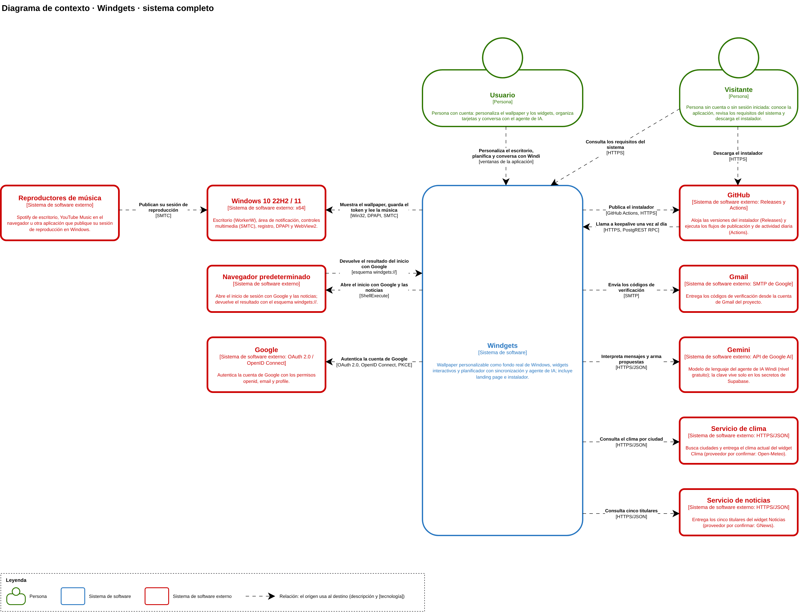

Muestra a Windgets como una sola caja, las dos personas que la usan y los sistemas con los que se comunica. La nube de Windgets (Supabase), la landing page y el instalador están dentro de la caja; Windows, los reproductores de música, el navegador predeterminado, Google, Gmail, Gemini, los servicios de clima y noticias y GitHub son externos.

### Elementos de la vista 1

| Nombre | Tipo | Tecnología | Responsabilidad | HU, ET, RNF y D que lo justifican |
|---|---|---|---|---|
| Usuario | Persona | — | Persona con cuenta: personaliza el wallpaper y los widgets, organiza tarjetas y conversa con el agente de IA. | HE-02 a HE-17; D-025 |
| Visitante | Persona | — | Persona sin cuenta o sin sesión iniciada: conoce la aplicación, revisa los requisitos del sistema y descarga el instalador. | CD-01, CD-02, HE-01; D-025 |
| Reproductores de música | Sistema de software externo | — | Spotify de escritorio, YouTube Music en el navegador u otra aplicación que publique su sesión de reproducción en Windows. | HE-04-HU11; D-175 |
| Windows 10 22H2 / 11 | Sistema de software externo | x64 | Escritorio (WorkerW), área de notificación, controles multimedia (SMTC), registro, DPAPI y WebView2. | D-050, D-131, D-175, D-192; RNF-32, RNF-33 |
| Navegador predeterminado | Sistema de software externo | — | Abre el inicio de sesión con Google y las noticias; devuelve el resultado con el esquema windgets://. | HE-01-HU05, HE-06-HU10; RNF-36; D-191 |
| Google | Sistema de software externo | OAuth 2.0 / OpenID Connect | Autentica la cuenta de Google con los permisos openid, email y profile. | HE-01-HU05; RNF-20; D-181 |
| Windgets | Sistema de software | — | Wallpaper personalizable como fondo real de Windows, widgets interactivos y planificador con sincronización y agente de IA; incluye landing page e instalador. | HE-01 a HE-17, CD-01, CD-02; D-179, D-133 |
| GitHub | Sistema de software externo | Releases y Actions | Aloja las versiones del instalador (Releases) y ejecuta los flujos de publicación y de actividad diaria (Actions). | CD-01-HU02; D-195, D-197 |
| Gmail | Sistema de software externo | SMTP de Google | Entrega los códigos de verificación desde la cuenta de Gmail del proyecto. | HE-01-HU03, HE-01-HU06; D-195 |
| Gemini | Sistema de software externo | API de Google AI | Modelo de lenguaje del agente de IA Windi (nivel gratuito); la clave vive solo en los secretos de Supabase. | HE-14; D-132, D-193 |
| Servicio de clima | Sistema de software externo | HTTPS/JSON | Busca ciudades y entrega el clima actual del widget Clima (proveedor por confirmar: Open-Meteo). | HE-04-HU05; D-139; RNF-09 |
| Servicio de noticias | Sistema de software externo | HTTPS/JSON | Entrega los cinco titulares del widget Noticias (proveedor por confirmar: GNews). | HE-04-HU06; D-139; RNF-09 |

### Relaciones de la vista 1

| Origen | Destino | Descripción | Protocolo o tecnología |
|---|---|---|---|
| Visitante | Windgets | Consulta los requisitos del sistema | HTTPS |
| Visitante | GitHub | Descarga el instalador | HTTPS |
| Usuario | Windgets | Personaliza el escritorio, planifica y conversa con Windi | ventanas de la aplicación |
| Reproductores de música | Windows 10 22H2 / 11 | Publican su sesión de reproducción | SMTC |
| Windgets | Windows 10 22H2 / 11 | Muestra el wallpaper, guarda el token y lee la música | Win32, DPAPI, SMTC |
| Windgets | Navegador predeterminado | Abre el inicio con Google y las noticias | ShellExecute |
| Navegador predeterminado | Windgets | Devuelve el resultado del inicio con Google | esquema windgets:// |
| Windgets | Google | Autentica la cuenta de Google | OAuth 2.0, OpenID Connect, PKCE |
| Windgets | Gmail | Envía los códigos de verificación | SMTP |
| Windgets | Gemini | Interpreta mensajes y arma propuestas | HTTPS/JSON |
| Windgets | Servicio de clima | Consulta el clima por ciudad | HTTPS/JSON |
| Windgets | Servicio de noticias | Consulta cinco titulares | HTTPS/JSON |
| Windgets | GitHub | Publica el instalador | GitHub Actions, HTTPS |
| GitHub | Windgets | Llama a keepalive una vez al día | HTTPS, PostgREST RPC |

Los proveedores de clima y de noticias no los fija el backlog: la propuesta es Open-Meteo y GNews (nivel gratuito) y se confirma al construir (véase «Dudas y propuestas»).

## C4 · 2. Vista 2a · Contenedores: aplicación de escritorio

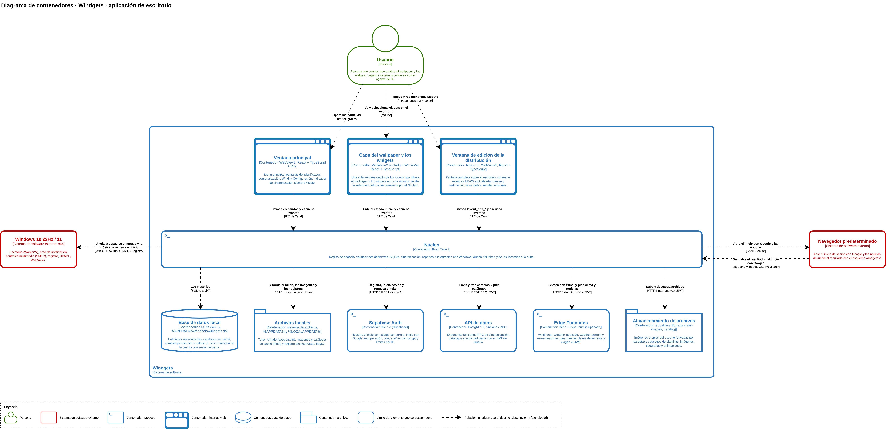

Contenedores de Windgets que se ejecutan en el computador del usuario: tres vistas WebView2 (D-185), el Núcleo en Rust, la base de datos local y los archivos locales; la nube se muestra solo como los cuatro contenedores que el Núcleo llama. La ventana de edición existe solo mientras la pantalla de edición de HE-05 está abierta. El Núcleo es el único que habla con Windows, el navegador y la nube.

### Elementos de la vista 2a

| Nombre | Tipo | Tecnología | Responsabilidad | HU, ET, RNF y D que lo justifican |
|---|---|---|---|---|
| Usuario | Persona | — | Persona con cuenta: personaliza el wallpaper y los widgets, organiza tarjetas y conversa con el agente de IA. | HE-02 a HE-17; D-025 |
| Ventana principal | Contenedor | WebView2, React + TypeScript + Vite | Menú principal, pantallas del planificador, personalización, Windi y Configuración; indicador de sincronización siempre visible. | HE-01 a HE-04, HE-07 a HE-17; D-179, D-185, D-188, D-203 |
| Capa del wallpaper y los widgets | Contenedor | WebView2 anclada a WorkerW, React + TypeScript | Una sola ventana detrás de los íconos que dibuja el wallpaper y los widgets en cada monitor; recibe la selección del mouse reenviada por el Núcleo. | HE-02-HU01, HE-04, HE-06; D-131, D-185, D-186, D-187 |
| Ventana de edición de la distribución | Contenedor | temporal, WebView2, React + TypeScript | Pantalla completa sobre el escritorio, sin menú, mientras HE-05 está abierta; mueve y redimensiona widgets y señala colisiones. | HE-05; D-185 |
| Núcleo | Contenedor | Rust, Tauri 2 | Reglas de negocio, validaciones definitivas, SQLite, sincronización, reportes e integración con Windows; dueño del token y de las llamadas a la nube. | HE-01 a HE-17; D-179, D-188, D-189, D-191, D-192 |
| Base de datos local | Contenedor | SQLite (WAL), %APPDATA%\Windgets\windgets.db | Entidades sincronizadas, catálogos en caché, cambios pendientes y estado de sincronización de la cuenta con sesión iniciada. | HE-15-HU02; RNF-12, RNF-14; D-164, D-179, D-190 |
| Archivos locales | Contenedor | sistema de archivos, %APPDATA% y %LOCALAPPDATA% | Token cifrado (session.bin), imágenes y catálogos en caché (files\) y registro técnico rotado (logs\). | RNF-19, RNF-22, RNF-23; D-192, D-196, D-198 |
| Supabase Auth | Contenedor | GoTrue (Supabase) | Registro e inicio con código por correo, inicio con Google, recuperación, contraseñas con bcrypt y límites por IP. | HE-01; RNF-17, RNF-20, RNF-24, RNF-25; D-176, D-195 |
| API de datos | Contenedor | PostgREST, funciones RPC | Expone las funciones RPC de sincronización, catálogos y actividad diaria con el JWT del usuario. | HE-15; RNF-03, RNF-04, RNF-21; D-048, D-049, D-189 |
| Edge Functions | Contenedor | Deno + TypeScript (Supabase) | windi-chat, weather-geocode, weather-current y news-headlines; guardan las claves de terceros y exigen el JWT. | HE-14, HE-04-HU05, HE-04-HU06; RNF-09, RNF-11; D-132, D-180, D-192 |
| Almacenamiento de archivos | Contenedor | Supabase Storage (user-images, catalog) | Imágenes propias del usuario (privadas por carpeta) y catálogos de plantillas, imágenes, tipografías y animaciones. | RNF-21, RNF-22, RNF-23; D-180, D-198 |
| Windows 10 22H2 / 11 | Sistema de software externo | x64 | Escritorio (WorkerW), área de notificación, controles multimedia (SMTC), registro, DPAPI y WebView2. | D-050, D-131, D-175, D-192; RNF-32, RNF-33 |
| Navegador predeterminado | Sistema de software externo | — | Abre el inicio de sesión con Google y las noticias; devuelve el resultado con el esquema windgets://. | HE-01-HU05, HE-06-HU10; RNF-36; D-191 |

### Límites de la vista 2a

| Límite | Tipo | Tecnología | Contiene |
|---|---|---|---|
| Windgets | Sistema de software | — | Ventana principal, Capa del wallpaper y los widgets, Ventana de edición de la distribución, Núcleo, Base de datos local, Archivos locales, Supabase Auth, API de datos, Edge Functions, Almacenamiento de archivos |

### Relaciones de la vista 2a

| Origen | Destino | Descripción | Protocolo o tecnología |
|---|---|---|---|
| Usuario | Ventana principal | Opera las pantallas | interfaz gráfica |
| Usuario | Capa del wallpaper y los widgets | Ve y selecciona widgets en el escritorio | mouse |
| Usuario | Ventana de edición de la distribución | Mueve y redimensiona widgets | mouse, arrastrar y soltar |
| Ventana principal | Núcleo | Invoca comandos y escucha eventos | IPC de Tauri |
| Capa del wallpaper y los widgets | Núcleo | Pide el estado inicial y escucha eventos | IPC de Tauri |
| Ventana de edición de la distribución | Núcleo | Invoca layout_edit_* y escucha eventos | IPC de Tauri |
| Núcleo | Base de datos local | Lee y escribe | SQLite (sqlx) |
| Núcleo | Archivos locales | Guarda el token, las imágenes y los registros | DPAPI, sistema de archivos |
| Núcleo | Supabase Auth | Registra, inicia sesión y renueva el token | HTTPS/REST (auth/v1) |
| Núcleo | API de datos | Envía y trae cambios y pide catálogos | PostgREST RPC, JWT |
| Núcleo | Edge Functions | Chatea con Windi y pide clima y noticias | HTTPS (functions/v1), JWT |
| Núcleo | Almacenamiento de archivos | Sube y descarga archivos | HTTPS (storage/v1), JWT |
| Núcleo | Windows 10 22H2 / 11 | Ancla la capa, lee el mouse y la música, y registra el inicio | Win32, Raw Input, SMTC, registro |
| Núcleo | Navegador predeterminado | Abre el inicio con Google y las noticias | ShellExecute |
| Navegador predeterminado | Núcleo | Devuelve el resultado del inicio con Google | esquema windgets://auth/callback |

## C4 · 3. Vista 2b · Contenedores: nube en Supabase

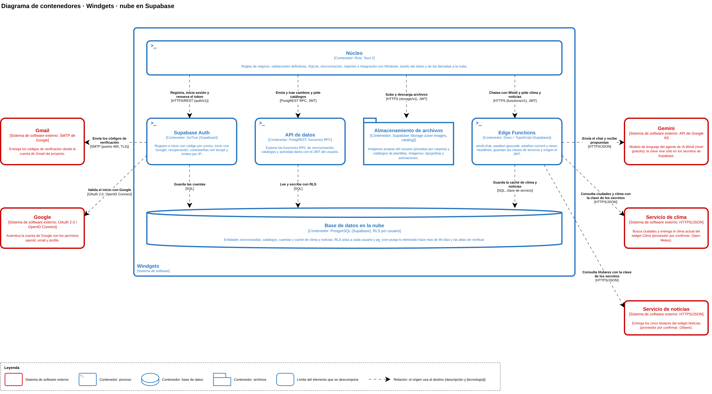

Contenedores de la nube de Windgets (Supabase, plan gratuito) y los sistemas externos que usan. No hay servidor propio: todo el lado del servidor es Supabase. Las claves de Gemini, clima y noticias solo las leen las Edge Functions. El Núcleo es el único cliente de estos contenedores.

### Elementos de la vista 2b

| Nombre | Tipo | Tecnología | Responsabilidad | HU, ET, RNF y D que lo justifican |
|---|---|---|---|---|
| Núcleo | Contenedor | Rust, Tauri 2 | Reglas de negocio, validaciones definitivas, SQLite, sincronización, reportes e integración con Windows; dueño del token y de las llamadas a la nube. | HE-01 a HE-17; D-179, D-188, D-189, D-191, D-192 |
| Supabase Auth | Contenedor | GoTrue (Supabase) | Registro e inicio con código por correo, inicio con Google, recuperación, contraseñas con bcrypt y límites por IP. | HE-01; RNF-17, RNF-20, RNF-24, RNF-25; D-176, D-195 |
| API de datos | Contenedor | PostgREST, funciones RPC | Expone las funciones RPC de sincronización, catálogos y actividad diaria con el JWT del usuario. | HE-15; RNF-03, RNF-04, RNF-21; D-048, D-049, D-189 |
| Almacenamiento de archivos | Contenedor | Supabase Storage (user-images, catalog) | Imágenes propias del usuario (privadas por carpeta) y catálogos de plantillas, imágenes, tipografías y animaciones. | RNF-21, RNF-22, RNF-23; D-180, D-198 |
| Edge Functions | Contenedor | Deno + TypeScript (Supabase) | windi-chat, weather-geocode, weather-current y news-headlines; guardan las claves de terceros y exigen el JWT. | HE-14, HE-04-HU05, HE-04-HU06; RNF-09, RNF-11; D-132, D-180, D-192 |
| Base de datos en la nube | Contenedor | PostgreSQL (Supabase), RLS por usuario | Entidades sincronizadas, catálogos, cuentas y caché de clima y noticias; RLS aísla a cada usuario y pg_cron purga lo eliminado hace más de 90 días y las altas sin verificar. | HE-15; RNF-21; D-133, D-180 |
| Gmail | Sistema de software externo | SMTP de Google | Entrega los códigos de verificación desde la cuenta de Gmail del proyecto. | HE-01-HU03, HE-01-HU06; D-195 |
| Google | Sistema de software externo | OAuth 2.0 / OpenID Connect | Autentica la cuenta de Google con los permisos openid, email y profile. | HE-01-HU05; RNF-20; D-181 |
| Gemini | Sistema de software externo | API de Google AI | Modelo de lenguaje del agente de IA Windi (nivel gratuito); la clave vive solo en los secretos de Supabase. | HE-14; D-132, D-193 |
| Servicio de clima | Sistema de software externo | HTTPS/JSON | Busca ciudades y entrega el clima actual del widget Clima (proveedor por confirmar: Open-Meteo). | HE-04-HU05; D-139; RNF-09 |
| Servicio de noticias | Sistema de software externo | HTTPS/JSON | Entrega los cinco titulares del widget Noticias (proveedor por confirmar: GNews). | HE-04-HU06; D-139; RNF-09 |

### Límites de la vista 2b

| Límite | Tipo | Tecnología | Contiene |
|---|---|---|---|
| Windgets | Sistema de software | — | Núcleo, Supabase Auth, API de datos, Almacenamiento de archivos, Edge Functions, Base de datos en la nube |

### Relaciones de la vista 2b

| Origen | Destino | Descripción | Protocolo o tecnología |
|---|---|---|---|
| Núcleo | Supabase Auth | Registra, inicia sesión y renueva el token | HTTPS/REST (auth/v1) |
| Núcleo | API de datos | Envía y trae cambios y pide catálogos | PostgREST RPC, JWT |
| Núcleo | Almacenamiento de archivos | Sube y descarga archivos | HTTPS (storage/v1), JWT |
| Núcleo | Edge Functions | Chatea con Windi y pide clima y noticias | HTTPS (functions/v1), JWT |
| Supabase Auth | Base de datos en la nube | Guarda las cuentas | SQL |
| API de datos | Base de datos en la nube | Lee y escribe con RLS | SQL |
| Edge Functions | Base de datos en la nube | Guarda la caché de clima y noticias | SQL, clave de servicio |
| Supabase Auth | Gmail | Envía los códigos de verificación | SMTP (puerto 465, TLS) |
| Supabase Auth | Google | Valida el inicio con Google | OAuth 2.0, OpenID Connect |
| Edge Functions | Gemini | Envía el chat y recibe propuestas | HTTPS/JSON |
| Edge Functions | Servicio de clima | Consulta ciudades y clima con la clave de los secretos | HTTPS/JSON |
| Edge Functions | Servicio de noticias | Consulta titulares con la clave de los secretos | HTTPS/JSON |

Los proveedores de clima y de noticias no los fija el backlog: la propuesta es Open-Meteo y GNews (nivel gratuito) y se confirma al construir (véase «Dudas y propuestas»).

## C4 · 4. Vista 2c · Contenedores: distribución

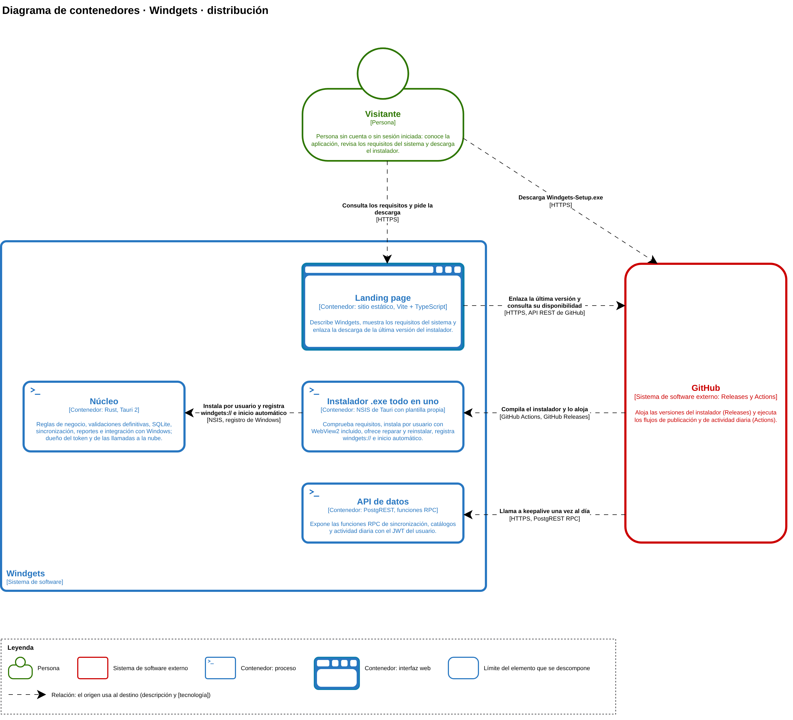

Contenedores de distribución: la landing page, el instalador y su relación con GitHub, que compila y aloja el instalador y llama una vez al día a `keepalive` (D-197). El instalador instala el Núcleo (la aplicación) en el computador del usuario.

### Elementos de la vista 2c

| Nombre | Tipo | Tecnología | Responsabilidad | HU, ET, RNF y D que lo justifican |
|---|---|---|---|---|
| Visitante | Persona | — | Persona sin cuenta o sin sesión iniciada: conoce la aplicación, revisa los requisitos del sistema y descarga el instalador. | CD-01, CD-02, HE-01; D-025 |
| Núcleo | Contenedor | Rust, Tauri 2 | Reglas de negocio, validaciones definitivas, SQLite, sincronización, reportes e integración con Windows; dueño del token y de las llamadas a la nube. | HE-01 a HE-17; D-179, D-188, D-189, D-191, D-192 |
| Landing page | Contenedor | sitio estático, Vite + TypeScript | Describe Windgets, muestra los requisitos del sistema y enlaza la descarga de la última versión del instalador. | CD-01; D-195 |
| Instalador .exe todo en uno | Contenedor | NSIS de Tauri con plantilla propia | Comprueba requisitos, instala por usuario con WebView2 incluido, ofrece reparar y reinstalar, registra windgets:// e inicio automático. | CD-02; RNF-15; D-179, D-194 |
| API de datos | Contenedor | PostgREST, funciones RPC | Expone las funciones RPC de sincronización, catálogos y actividad diaria con el JWT del usuario. | HE-15; RNF-03, RNF-04, RNF-21; D-048, D-049, D-189 |
| GitHub | Sistema de software externo | Releases y Actions | Aloja las versiones del instalador (Releases) y ejecuta los flujos de publicación y de actividad diaria (Actions). | CD-01-HU02; D-195, D-197 |

### Límites de la vista 2c

| Límite | Tipo | Tecnología | Contiene |
|---|---|---|---|
| Windgets | Sistema de software | — | Landing page, Instalador .exe todo en uno, Núcleo, API de datos |

### Relaciones de la vista 2c

| Origen | Destino | Descripción | Protocolo o tecnología |
|---|---|---|---|
| Visitante | Landing page | Consulta los requisitos y pide la descarga | HTTPS |
| Visitante | GitHub | Descarga Windgets-Setup.exe | HTTPS |
| Landing page | GitHub | Enlaza la última versión y consulta su disponibilidad | HTTPS, API REST de GitHub |
| GitHub | Instalador .exe todo en uno | Compila el instalador y lo aloja | GitHub Actions, GitHub Releases |
| Instalador .exe todo en uno | Núcleo | Instala por usuario y registra windgets:// e inicio automático | NSIS, registro de Windows |
| GitHub | API de datos | Llama a keepalive una vez al día | HTTPS, PostgREST RPC |

## C4 · 5. Vista 3a · Componentes: Núcleo · servicios de negocio y datos locales

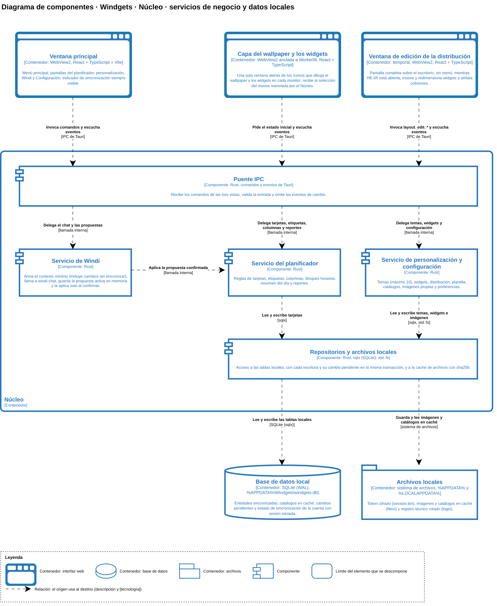

Componentes del Núcleo que aplican las reglas de negocio y acceden a los datos locales. Las tres vistas se comunican con el Puente IPC, que delega en los servicios; los servicios guardan por Repositorios y archivos locales.

### Elementos de la vista 3a

| Nombre | Tipo | Tecnología | Responsabilidad | HU, ET, RNF y D que lo justifican |
|---|---|---|---|---|
| Ventana principal | Contenedor | WebView2, React + TypeScript + Vite | Menú principal, pantallas del planificador, personalización, Windi y Configuración; indicador de sincronización siempre visible. | HE-01 a HE-04, HE-07 a HE-17; D-179, D-185, D-188, D-203 |
| Capa del wallpaper y los widgets | Contenedor | WebView2 anclada a WorkerW, React + TypeScript | Una sola ventana detrás de los íconos que dibuja el wallpaper y los widgets en cada monitor; recibe la selección del mouse reenviada por el Núcleo. | HE-02-HU01, HE-04, HE-06; D-131, D-185, D-186, D-187 |
| Ventana de edición de la distribución | Contenedor | temporal, WebView2, React + TypeScript | Pantalla completa sobre el escritorio, sin menú, mientras HE-05 está abierta; mueve y redimensiona widgets y señala colisiones. | HE-05; D-185 |
| Puente IPC | Componente | Rust, comandos y eventos de Tauri | Recibe los comandos de las tres vistas, valida la entrada y emite los eventos de cambio. | Todas las épicas; D-185, D-188 |
| Servicio de Windi | Componente | Rust | Arma el contexto mínimo (incluye cambios sin sincronizar), llama a windi-chat, guarda la propuesta activa en memoria y la aplica solo al confirmar. | HE-14; RNF-11; D-047, D-132, D-193 |
| Servicio del planificador | Componente | Rust | Reglas de tarjetas, etiquetas, columnas, bloques horarios, resumen del día y reportes. | HE-07 a HE-13; D-188 |
| Servicio de personalización y configuración | Componente | Rust | Temas (máximo 10), widgets, distribución, plantilla, catálogos, imágenes propias y preferencias. | HE-02 a HE-05; RNF-02, RNF-22, RNF-23; D-135, D-198 |
| Repositorios y archivos locales | Componente | Rust, sqlx (SQLite), std::fs | Acceso a las tablas locales, con cada escritura y su cambio pendiente en la misma transacción, y a la caché de archivos con sha256. | HE-15-HU02; RNF-12, RNF-14; D-164, D-190, D-198 |
| Base de datos local | Contenedor | SQLite (WAL), %APPDATA%\Windgets\windgets.db | Entidades sincronizadas, catálogos en caché, cambios pendientes y estado de sincronización de la cuenta con sesión iniciada. | HE-15-HU02; RNF-12, RNF-14; D-164, D-179, D-190 |
| Archivos locales | Contenedor | sistema de archivos, %APPDATA% y %LOCALAPPDATA% | Token cifrado (session.bin), imágenes y catálogos en caché (files\) y registro técnico rotado (logs\). | RNF-19, RNF-22, RNF-23; D-192, D-196, D-198 |

### Límites de la vista 3a

| Límite | Tipo | Tecnología | Contiene |
|---|---|---|---|
| Núcleo | Contenedor | — | Puente IPC, Servicio de Windi, Servicio del planificador, Servicio de personalización y configuración, Repositorios y archivos locales |

### Relaciones de la vista 3a

| Origen | Destino | Descripción | Protocolo o tecnología |
|---|---|---|---|
| Ventana principal | Puente IPC | Invoca comandos y escucha eventos | IPC de Tauri |
| Capa del wallpaper y los widgets | Puente IPC | Pide el estado inicial y escucha eventos | IPC de Tauri |
| Ventana de edición de la distribución | Puente IPC | Invoca layout_edit_* y escucha eventos | IPC de Tauri |
| Puente IPC | Servicio de Windi | Delega el chat y las propuestas | llamada interna |
| Puente IPC | Servicio del planificador | Delega tarjetas, etiquetas, columnas y reportes | llamada interna |
| Puente IPC | Servicio de personalización y configuración | Delega temas, widgets y configuración | llamada interna |
| Servicio de Windi | Servicio del planificador | Aplica la propuesta confirmada | llamada interna |
| Servicio del planificador | Repositorios y archivos locales | Lee y escribe tarjetas | sqlx |
| Servicio de personalización y configuración | Repositorios y archivos locales | Lee y escribe temas, widgets e imágenes | sqlx, std::fs |
| Repositorios y archivos locales | Base de datos local | Lee y escribe las tablas locales | SQLite (sqlx) |
| Repositorios y archivos locales | Archivos locales | Guarda y lee imágenes y catálogos en caché | sistema de archivos |

## C4 · 6. Vista 3b · Componentes: Núcleo · servicios que usan la nube

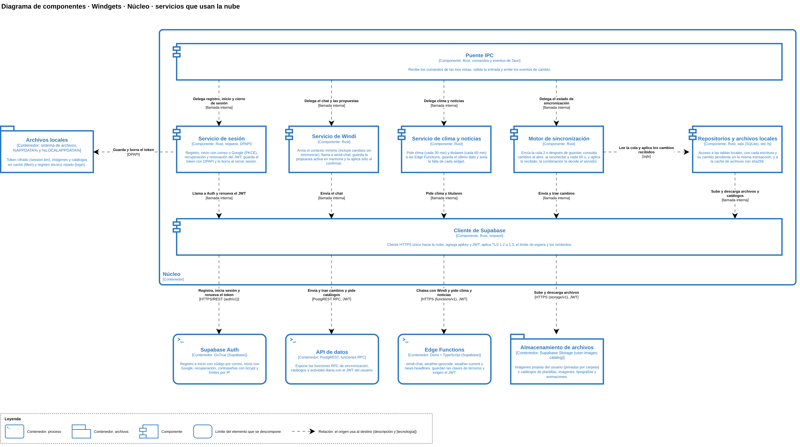

Componentes del Núcleo que llaman a la nube. Todos los servicios hablan con Supabase por el Cliente de Supabase, que agrega el JWT; el Servicio de sesión guarda el token en los archivos locales (DPAPI). El Cliente de Supabase llama a los cuatro contenedores de la nube.

### Elementos de la vista 3b

| Nombre | Tipo | Tecnología | Responsabilidad | HU, ET, RNF y D que lo justifican |
|---|---|---|---|---|
| Archivos locales | Contenedor | sistema de archivos, %APPDATA% y %LOCALAPPDATA% | Token cifrado (session.bin), imágenes y catálogos en caché (files\) y registro técnico rotado (logs\). | RNF-19, RNF-22, RNF-23; D-192, D-196, D-198 |
| Puente IPC | Componente | Rust, comandos y eventos de Tauri | Recibe los comandos de las tres vistas, valida la entrada y emite los eventos de cambio. | Todas las épicas; D-185, D-188 |
| Servicio de sesión | Componente | Rust, reqwest, DPAPI | Registro, inicio con correo o Google (PKCE), recuperación y renovación del JWT; guarda el token con DPAPI y lo borra al cerrar sesión. | HE-01, HE-16-HU03; RNF-19, RNF-36; D-190, D-191, D-192 |
| Servicio de Windi | Componente | Rust | Arma el contexto mínimo (incluye cambios sin sincronizar), llama a windi-chat, guarda la propuesta activa en memoria y la aplica solo al confirmar. | HE-14; RNF-11; D-047, D-132, D-193 |
| Servicio de clima y noticias | Componente | Rust | Pide clima (cada 30 min) y titulares (cada 60 min) a las Edge Functions, guarda el último dato y aísla la falla de cada widget. | HE-04-HU05, HE-04-HU06; RNF-09, RNF-13; D-139 |
| Motor de sincronización | Componente | Rust | Envía la cola 2 s después de guardar, consulta cambios al abrir, al reconectar y cada 60 s, y aplica lo recibido; la combinación la decide el servidor. | HE-15, HE-16-HU01; RNF-03, RNF-04, RNF-16; D-048, D-049, D-189 |
| Repositorios y archivos locales | Componente | Rust, sqlx (SQLite), std::fs | Acceso a las tablas locales, con cada escritura y su cambio pendiente en la misma transacción, y a la caché de archivos con sha256. | HE-15-HU02; RNF-12, RNF-14; D-164, D-190, D-198 |
| Cliente de Supabase | Componente | Rust, reqwest | Cliente HTTPS único hacia la nube: agrega apikey y JWT, aplica TLS 1.2 o 1.3, el límite de espera y los reintentos. | HE-15; RNF-18, RNF-21; D-180, D-192 |
| Supabase Auth | Contenedor | GoTrue (Supabase) | Registro e inicio con código por correo, inicio con Google, recuperación, contraseñas con bcrypt y límites por IP. | HE-01; RNF-17, RNF-20, RNF-24, RNF-25; D-176, D-195 |
| API de datos | Contenedor | PostgREST, funciones RPC | Expone las funciones RPC de sincronización, catálogos y actividad diaria con el JWT del usuario. | HE-15; RNF-03, RNF-04, RNF-21; D-048, D-049, D-189 |
| Edge Functions | Contenedor | Deno + TypeScript (Supabase) | windi-chat, weather-geocode, weather-current y news-headlines; guardan las claves de terceros y exigen el JWT. | HE-14, HE-04-HU05, HE-04-HU06; RNF-09, RNF-11; D-132, D-180, D-192 |
| Almacenamiento de archivos | Contenedor | Supabase Storage (user-images, catalog) | Imágenes propias del usuario (privadas por carpeta) y catálogos de plantillas, imágenes, tipografías y animaciones. | RNF-21, RNF-22, RNF-23; D-180, D-198 |

### Límites de la vista 3b

| Límite | Tipo | Tecnología | Contiene |
|---|---|---|---|
| Núcleo | Contenedor | — | Puente IPC, Servicio de sesión, Servicio de Windi, Servicio de clima y noticias, Motor de sincronización, Repositorios y archivos locales, Cliente de Supabase |

### Relaciones de la vista 3b

| Origen | Destino | Descripción | Protocolo o tecnología |
|---|---|---|---|
| Puente IPC | Servicio de sesión | Delega registro, inicio y cierre de sesión | llamada interna |
| Puente IPC | Servicio de Windi | Delega el chat y las propuestas | llamada interna |
| Puente IPC | Servicio de clima y noticias | Delega clima y noticias | llamada interna |
| Puente IPC | Motor de sincronización | Delega el estado de sincronización | llamada interna |
| Motor de sincronización | Repositorios y archivos locales | Lee la cola y aplica los cambios recibidos | sqlx |
| Servicio de sesión | Archivos locales | Guarda y borra el token | DPAPI |
| Servicio de sesión | Cliente de Supabase | Llama a Auth y renueva el JWT | llamada interna |
| Servicio de Windi | Cliente de Supabase | Envía el chat | llamada interna |
| Servicio de clima y noticias | Cliente de Supabase | Pide clima y titulares | llamada interna |
| Motor de sincronización | Cliente de Supabase | Envía y trae cambios | llamada interna |
| Repositorios y archivos locales | Cliente de Supabase | Sube y descarga archivos y catálogos | llamada interna |
| Cliente de Supabase | Supabase Auth | Registra, inicia sesión y renueva el token | HTTPS/REST (auth/v1) |
| Cliente de Supabase | API de datos | Envía y trae cambios y pide catálogos | PostgREST RPC, JWT |
| Cliente de Supabase | Edge Functions | Chatea con Windi y pide clima y noticias | HTTPS (functions/v1), JWT |
| Cliente de Supabase | Almacenamiento de archivos | Sube y descarga archivos | HTTPS (storage/v1), JWT |

## C4 · 7. Vista 3c · Componentes: Núcleo · integración con Windows

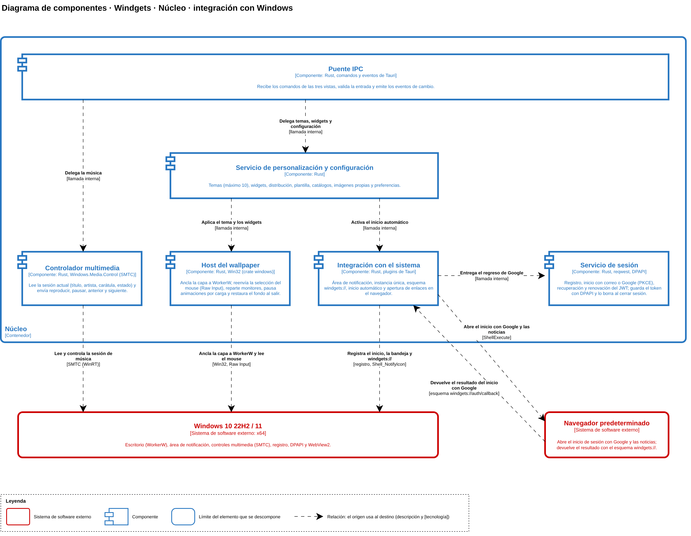

Componentes del Núcleo que se integran con Windows y con el navegador predeterminado: Host del wallpaper, Controlador multimedia e Integración con el sistema. El regreso del inicio con Google llega por `windgets://` a Integración con el sistema, que lo entrega al Servicio de sesión. Los eventos hacia las vistas salen por el Puente IPC.

### Elementos de la vista 3c

| Nombre | Tipo | Tecnología | Responsabilidad | HU, ET, RNF y D que lo justifican |
|---|---|---|---|---|
| Puente IPC | Componente | Rust, comandos y eventos de Tauri | Recibe los comandos de las tres vistas, valida la entrada y emite los eventos de cambio. | Todas las épicas; D-185, D-188 |
| Servicio de personalización y configuración | Componente | Rust | Temas (máximo 10), widgets, distribución, plantilla, catálogos, imágenes propias y preferencias. | HE-02 a HE-05; RNF-02, RNF-22, RNF-23; D-135, D-198 |
| Controlador multimedia | Componente | Rust, Windows.Media.Control (SMTC) | Lee la sesión actual (título, artista, carátula, estado) y envía reproducir, pausar, anterior y siguiente. | HE-04-HU11, HE-06-HU09; D-175 |
| Host del wallpaper | Componente | Rust, Win32 (crate windows) | Ancla la capa a WorkerW, reenvía la selección del mouse (Raw Input), reparte monitores, pausa animaciones por carga y restaura el fondo al salir. | HE-02-HU01, HE-06-HU01; RNF-06, RNF-35; D-131, D-186, D-187 |
| Integración con el sistema | Componente | Rust, plugins de Tauri | Área de notificación, instancia única, esquema windgets://, inicio automático y apertura de enlaces en el navegador. | HE-16-HU02, HE-17, HE-01-HU05; D-051, D-191 |
| Servicio de sesión | Componente | Rust, reqwest, DPAPI | Registro, inicio con correo o Google (PKCE), recuperación y renovación del JWT; guarda el token con DPAPI y lo borra al cerrar sesión. | HE-01, HE-16-HU03; RNF-19, RNF-36; D-190, D-191, D-192 |
| Windows 10 22H2 / 11 | Sistema de software externo | x64 | Escritorio (WorkerW), área de notificación, controles multimedia (SMTC), registro, DPAPI y WebView2. | D-050, D-131, D-175, D-192; RNF-32, RNF-33 |
| Navegador predeterminado | Sistema de software externo | — | Abre el inicio de sesión con Google y las noticias; devuelve el resultado con el esquema windgets://. | HE-01-HU05, HE-06-HU10; RNF-36; D-191 |

### Límites de la vista 3c

| Límite | Tipo | Tecnología | Contiene |
|---|---|---|---|
| Núcleo | Contenedor | — | Puente IPC, Servicio de personalización y configuración, Controlador multimedia, Host del wallpaper, Integración con el sistema, Servicio de sesión |

### Relaciones de la vista 3c

| Origen | Destino | Descripción | Protocolo o tecnología |
|---|---|---|---|
| Puente IPC | Servicio de personalización y configuración | Delega temas, widgets y configuración | llamada interna |
| Puente IPC | Controlador multimedia | Delega la música | llamada interna |
| Servicio de personalización y configuración | Host del wallpaper | Aplica el tema y los widgets | llamada interna |
| Servicio de personalización y configuración | Integración con el sistema | Activa el inicio automático | llamada interna |
| Integración con el sistema | Servicio de sesión | Entrega el regreso de Google | llamada interna |
| Controlador multimedia | Windows 10 22H2 / 11 | Lee y controla la sesión de música | SMTC (WinRT) |
| Host del wallpaper | Windows 10 22H2 / 11 | Ancla la capa a WorkerW y lee el mouse | Win32, Raw Input |
| Integración con el sistema | Windows 10 22H2 / 11 | Registra el inicio, la bandeja y windgets:// | registro, Shell_NotifyIcon |
| Integración con el sistema | Navegador predeterminado | Abre el inicio con Google y las noticias | ShellExecute |
| Navegador predeterminado | Integración con el sistema | Devuelve el resultado del inicio con Google | esquema windgets://auth/callback |

## C4 · 8. Vista 3d · Componentes: Ventana principal

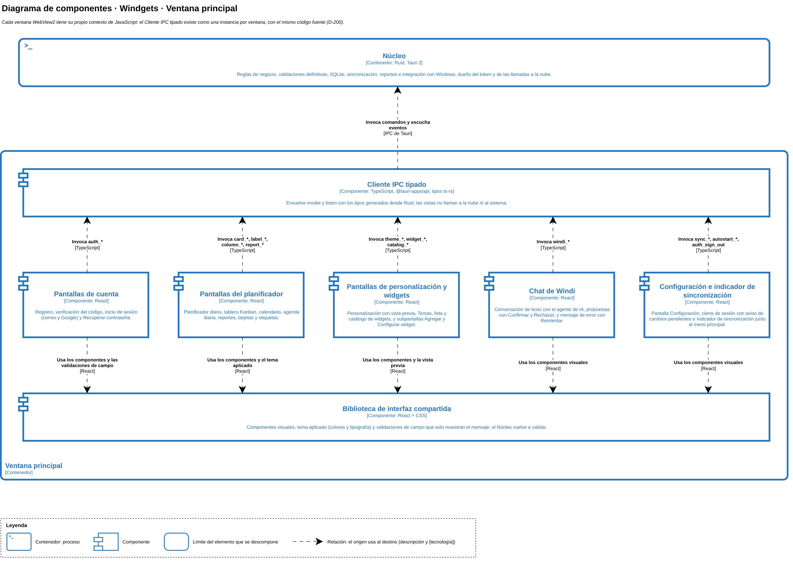

Componentes de la Ventana principal. Las pantallas no contienen reglas de negocio: presentan, repiten validaciones de campo solo para mostrar mensajes al instante y delegan todo en el Núcleo por el Cliente IPC tipado (D-188).

Cada ventana WebView2 tiene su propio contexto de JavaScript: el Cliente IPC tipado existe como una instancia por ventana, con el mismo código fuente (D-200).

### Elementos de la vista 3d

| Nombre | Tipo | Tecnología | Responsabilidad | HU, ET, RNF y D que lo justifican |
|---|---|---|---|---|
| Núcleo | Contenedor | Rust, Tauri 2 | Reglas de negocio, validaciones definitivas, SQLite, sincronización, reportes e integración con Windows; dueño del token y de las llamadas a la nube. | HE-01 a HE-17; D-179, D-188, D-189, D-191, D-192 |
| Cliente IPC tipado | Componente | TypeScript, @tauri-apps/api, tipos ts-rs | Envuelve invoke y listen con los tipos generados desde Rust; las vistas no llaman a la nube ni al sistema. | Todas las épicas; D-188 |
| Pantallas de cuenta | Componente | React | Registro, verificación del código, inicio de sesión (correo y Google) y Recuperar contraseña. | HE-01; RNF-25, RNF-27 |
| Pantallas del planificador | Componente | React | Planificador diario, tablero Kanban, calendario, agenda diaria, reportes, tarjetas y etiquetas. | HE-07 a HE-13; D-188 |
| Pantallas de personalización y widgets | Componente | React | Personalización con vista previa, Temas, lista y catálogo de widgets, y subpantallas Agregar y Configurar widget. | HE-02 a HE-04; RNF-02, RNF-26 |
| Chat de Windi | Componente | React | Conversación de texto con el agente de IA, propuestas con Confirmar y Rechazar, y mensaje de error con Reintentar. | HE-14; RNF-11; D-047, D-172 |
| Configuración e indicador de sincronización | Componente | React | Pantalla Configuración, cierre de sesión con aviso de cambios pendientes e indicador de sincronización junto al menú principal. | HE-15, HE-16; D-160, D-203 |
| Biblioteca de interfaz compartida | Componente | React + CSS | Componentes visuales, tema aplicado (colores y tipografía) y validaciones de campo que solo muestran el mensaje; el Núcleo vuelve a validar. | HE-03-HU06; RNF-26, RNF-29; D-188 |

### Límites de la vista 3d

| Límite | Tipo | Tecnología | Contiene |
|---|---|---|---|
| Ventana principal | Contenedor | — | Cliente IPC tipado, Pantallas de cuenta, Pantallas del planificador, Pantallas de personalización y widgets, Chat de Windi, Configuración e indicador de sincronización, Biblioteca de interfaz compartida |

### Relaciones de la vista 3d

| Origen | Destino | Descripción | Protocolo o tecnología |
|---|---|---|---|
| Cliente IPC tipado | Núcleo | Invoca comandos y escucha eventos | IPC de Tauri |
| Pantallas de cuenta | Cliente IPC tipado | Invoca auth_* | TypeScript |
| Pantallas del planificador | Cliente IPC tipado | Invoca card_*, label_*, column_*, report_* | TypeScript |
| Pantallas de personalización y widgets | Cliente IPC tipado | Invoca theme_*, widget_*, catalog_* | TypeScript |
| Chat de Windi | Cliente IPC tipado | Invoca windi_* | TypeScript |
| Configuración e indicador de sincronización | Cliente IPC tipado | Invoca sync_*, autostart_*, auth_sign_out | TypeScript |
| Pantallas de cuenta | Biblioteca de interfaz compartida | Usa los componentes y las validaciones de campo | React |
| Pantallas del planificador | Biblioteca de interfaz compartida | Usa los componentes y el tema aplicado | React |
| Pantallas de personalización y widgets | Biblioteca de interfaz compartida | Usa los componentes y la vista previa | React |
| Chat de Windi | Biblioteca de interfaz compartida | Usa los componentes visuales | React |
| Configuración e indicador de sincronización | Biblioteca de interfaz compartida | Usa los componentes visuales | React |

## C4 · 9. Vista 3e · Componentes: Capa del wallpaper y Ventana de edición

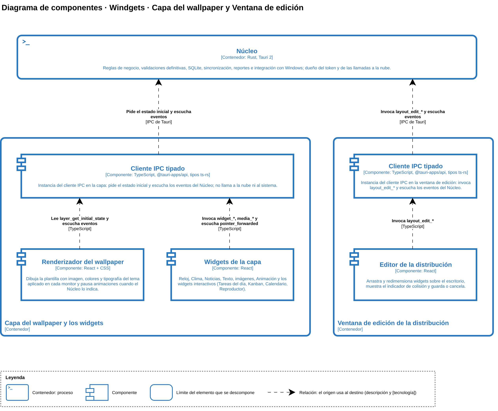

Componentes de la Capa del wallpaper y los widgets y de la Ventana de edición de la distribución. Ninguna llama a la nube ni al sistema: todo pasa por su instancia del Cliente IPC tipado.

### Elementos de la vista 3e

| Nombre | Tipo | Tecnología | Responsabilidad | HU, ET, RNF y D que lo justifican |
|---|---|---|---|---|
| Núcleo | Contenedor | Rust, Tauri 2 | Reglas de negocio, validaciones definitivas, SQLite, sincronización, reportes e integración con Windows; dueño del token y de las llamadas a la nube. | HE-01 a HE-17; D-179, D-188, D-189, D-191, D-192 |
| Cliente IPC tipado | Componente | TypeScript, @tauri-apps/api, tipos ts-rs | Instancia del cliente IPC en la capa: pide el estado inicial y escucha los eventos del Núcleo; no llama a la nube ni al sistema. | HE-02-HU01, HE-04, HE-06; D-185, D-188 |
| Renderizador del wallpaper | Componente | React + CSS | Dibuja la plantilla con imagen, colores y tipografía del tema aplicado en cada monitor y pausa animaciones cuando el Núcleo lo indica. | HE-02-HU01; RNF-06, RNF-34; D-187 |
| Widgets de la capa | Componente | React | Reloj, Clima, Noticias, Texto, imágenes, Animación y los widgets interactivos (Tareas del día, Kanban, Calendario, Reproductor). | HE-04, HE-06; RNF-31, RNF-35; D-186 |
| Cliente IPC tipado | Componente | TypeScript, @tauri-apps/api, tipos ts-rs | Instancia del cliente IPC en la ventana de edición: invoca layout_edit_* y escucha los eventos del Núcleo. | HE-05; D-185, D-188 |
| Editor de la distribución | Componente | React | Arrastra y redimensiona widgets sobre el escritorio, muestra el indicador de colisión y guarda o cancela. | HE-05; D-185 |

### Límites de la vista 3e

| Límite | Tipo | Tecnología | Contiene |
|---|---|---|---|
| Capa del wallpaper y los widgets | Contenedor | — | Cliente IPC tipado, Renderizador del wallpaper, Widgets de la capa |
| Ventana de edición de la distribución | Contenedor | — | Cliente IPC tipado, Editor de la distribución |

### Relaciones de la vista 3e

| Origen | Destino | Descripción | Protocolo o tecnología |
|---|---|---|---|
| Cliente IPC tipado | Núcleo | Pide el estado inicial y escucha eventos | IPC de Tauri |
| Renderizador del wallpaper | Cliente IPC tipado | Lee layer_get_initial_state y escucha eventos | TypeScript |
| Widgets de la capa | Cliente IPC tipado | Invoca widget_*, media_* y escucha pointer_forwarded | TypeScript |
| Cliente IPC tipado | Núcleo | Invoca layout_edit_* y escucha eventos | IPC de Tauri |
| Editor de la distribución | Cliente IPC tipado | Invoca layout_edit_* | TypeScript |

## C4 · 10. Vista 3f · Componentes: API de datos

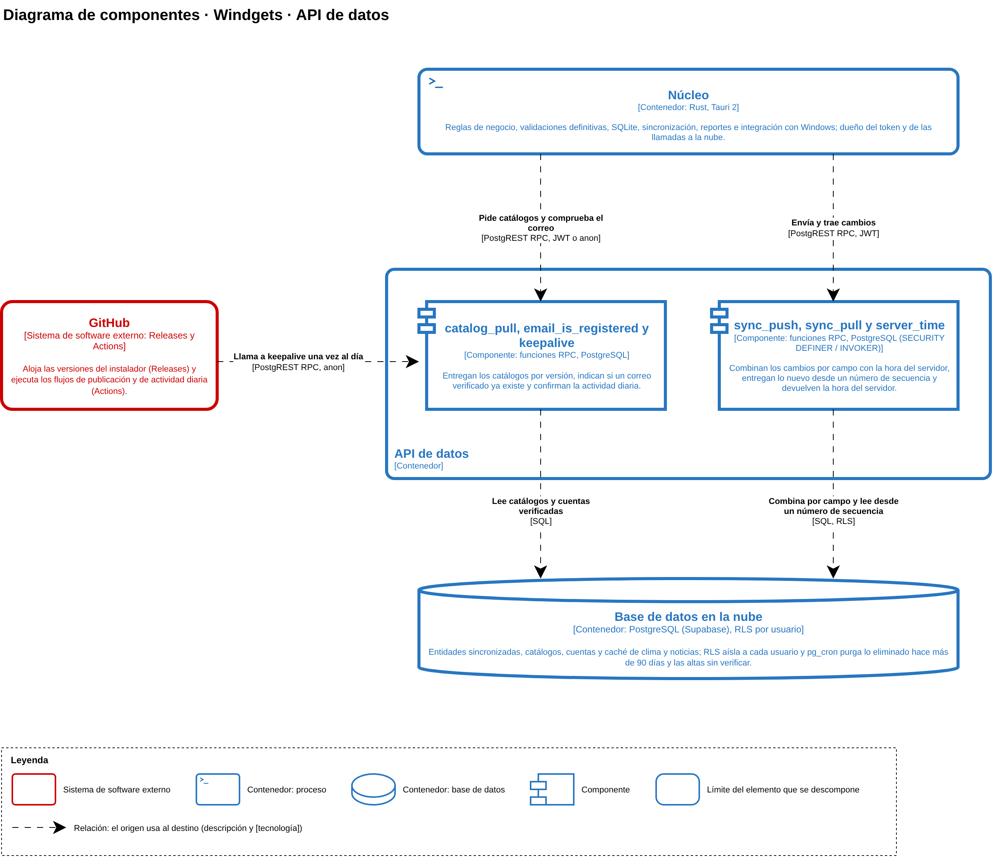

Componentes del contenedor API de datos: las funciones RPC de sincronización (la combinación de cambios por campo, D-048, ocurre solo aquí, D-189) y las funciones auxiliares, entre ellas `keepalive`, que llama GitHub Actions.

### Elementos de la vista 3f

| Nombre | Tipo | Tecnología | Responsabilidad | HU, ET, RNF y D que lo justifican |
|---|---|---|---|---|
| Núcleo | Contenedor | Rust, Tauri 2 | Reglas de negocio, validaciones definitivas, SQLite, sincronización, reportes e integración con Windows; dueño del token y de las llamadas a la nube. | HE-01 a HE-17; D-179, D-188, D-189, D-191, D-192 |
| GitHub | Sistema de software externo | Releases y Actions | Aloja las versiones del instalador (Releases) y ejecuta los flujos de publicación y de actividad diaria (Actions). | CD-01-HU02; D-195, D-197 |
| catalog_pull, email_is_registered y keepalive | Componente | funciones RPC, PostgreSQL | Entregan los catálogos por versión, indican si un correo verificado ya existe y confirman la actividad diaria. | HE-01-HU01, HE-15-HU01-ET09; D-197, D-198 |
| sync_push, sync_pull y server_time | Componente | funciones RPC, PostgreSQL (SECURITY DEFINER / INVOKER) | Combinan los cambios por campo con la hora del servidor, entregan lo nuevo desde un número de secuencia y devuelven la hora del servidor. | HE-15; RNF-16, RNF-21; D-048, D-189 |
| Base de datos en la nube | Contenedor | PostgreSQL (Supabase), RLS por usuario | Entidades sincronizadas, catálogos, cuentas y caché de clima y noticias; RLS aísla a cada usuario y pg_cron purga lo eliminado hace más de 90 días y las altas sin verificar. | HE-15; RNF-21; D-133, D-180 |

### Límites de la vista 3f

| Límite | Tipo | Tecnología | Contiene |
|---|---|---|---|
| API de datos | Contenedor | — | catalog_pull, email_is_registered y keepalive, sync_push, sync_pull y server_time |

### Relaciones de la vista 3f

| Origen | Destino | Descripción | Protocolo o tecnología |
|---|---|---|---|
| Núcleo | sync_push, sync_pull y server_time | Envía y trae cambios | PostgREST RPC, JWT |
| Núcleo | catalog_pull, email_is_registered y keepalive | Pide catálogos y comprueba el correo | PostgREST RPC, JWT o anon |
| GitHub | catalog_pull, email_is_registered y keepalive | Llama a keepalive una vez al día | PostgREST RPC, anon |
| sync_push, sync_pull y server_time | Base de datos en la nube | Combina por campo y lee desde un número de secuencia | SQL, RLS |
| catalog_pull, email_is_registered y keepalive | Base de datos en la nube | Lee catálogos y cuentas verificadas | SQL |

## C4 · 11. Vista 3g · Componentes: Edge Functions

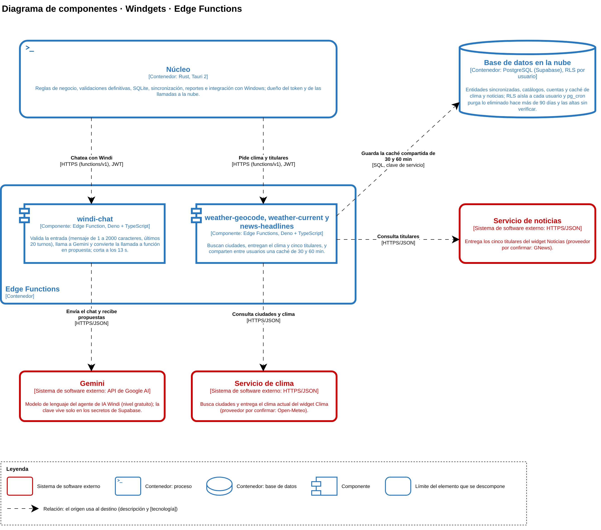

Componentes del contenedor Edge Functions: `windi-chat`, que llama a Gemini, y las funciones de clima y noticias, que comparten una caché en la base de datos. `windi-chat` no lee tarjetas de la base: recibe del Núcleo solo las necesarias para la pregunta (D-193).

### Elementos de la vista 3g

| Nombre | Tipo | Tecnología | Responsabilidad | HU, ET, RNF y D que lo justifican |
|---|---|---|---|---|
| Núcleo | Contenedor | Rust, Tauri 2 | Reglas de negocio, validaciones definitivas, SQLite, sincronización, reportes e integración con Windows; dueño del token y de las llamadas a la nube. | HE-01 a HE-17; D-179, D-188, D-189, D-191, D-192 |
| Base de datos en la nube | Contenedor | PostgreSQL (Supabase), RLS por usuario | Entidades sincronizadas, catálogos, cuentas y caché de clima y noticias; RLS aísla a cada usuario y pg_cron purga lo eliminado hace más de 90 días y las altas sin verificar. | HE-15; RNF-21; D-133, D-180 |
| windi-chat | Componente | Edge Function, Deno + TypeScript | Valida la entrada (mensaje de 1 a 2000 caracteres, últimos 20 turnos), llama a Gemini y convierte la llamada a función en propuesta; corta a los 13 s. | HE-14; RNF-11; D-132, D-193 |
| weather-geocode, weather-current y news-headlines | Componente | Edge Functions, Deno + TypeScript | Buscan ciudades, entregan el clima y cinco titulares, y comparten entre usuarios una caché de 30 y 60 min. | HE-04-HU05, HE-04-HU06; RNF-09; D-139 |
| Gemini | Sistema de software externo | API de Google AI | Modelo de lenguaje del agente de IA Windi (nivel gratuito); la clave vive solo en los secretos de Supabase. | HE-14; D-132, D-193 |
| Servicio de clima | Sistema de software externo | HTTPS/JSON | Busca ciudades y entrega el clima actual del widget Clima (proveedor por confirmar: Open-Meteo). | HE-04-HU05; D-139; RNF-09 |
| Servicio de noticias | Sistema de software externo | HTTPS/JSON | Entrega los cinco titulares del widget Noticias (proveedor por confirmar: GNews). | HE-04-HU06; D-139; RNF-09 |

### Límites de la vista 3g

| Límite | Tipo | Tecnología | Contiene |
|---|---|---|---|
| Edge Functions | Contenedor | — | windi-chat, weather-geocode, weather-current y news-headlines |

### Relaciones de la vista 3g

| Origen | Destino | Descripción | Protocolo o tecnología |
|---|---|---|---|
| Núcleo | windi-chat | Chatea con Windi | HTTPS (functions/v1), JWT |
| Núcleo | weather-geocode, weather-current y news-headlines | Pide clima y titulares | HTTPS (functions/v1), JWT |
| weather-geocode, weather-current y news-headlines | Base de datos en la nube | Guarda la caché compartida de 30 y 60 min | SQL, clave de servicio |
| windi-chat | Gemini | Envía el chat y recibe propuestas | HTTPS/JSON |
| weather-geocode, weather-current y news-headlines | Servicio de clima | Consulta ciudades y clima | HTTPS/JSON |
| weather-geocode, weather-current y news-headlines | Servicio de noticias | Consulta titulares | HTTPS/JSON |

## C4 · 12. Vista 4a · Código: Motor de sincronización

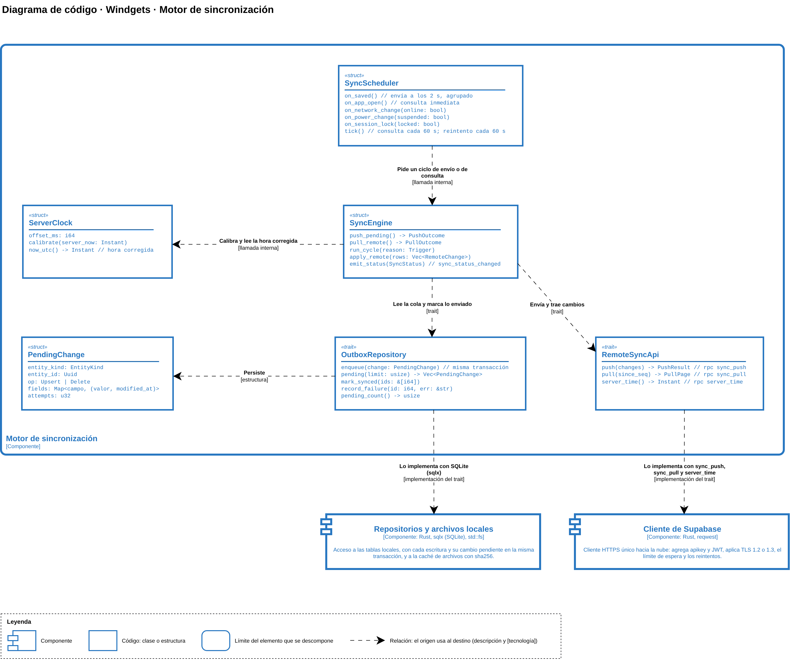

Clases y estructuras del componente Motor de sincronización, con sus funciones. Es el diseño de partida para construir; los nombres de funciones pueden variar al escribir el código, pero las responsabilidades y las relaciones se mantienen. Los traits `OutboxRepository` y `RemoteSyncApi` los implementan Repositorios y archivos locales y el Cliente de Supabase.

### Elementos de la vista 4a

| Nombre | Tipo | Tecnología | Responsabilidad | HU, ET, RNF y D que lo justifican |
|---|---|---|---|---|
| SyncScheduler | Clase (struct) | Rust · tokio | `on_saved()  // envía a los 2 s, agrupado`; `on_app_open()  // consulta inmediata`; `on_network_change(online: bool)`; `on_power_change(suspended: bool)`; `on_session_lock(locked: bool)`; `tick()  // consulta cada 60 s; reintento cada 60 s` | HE-15-HU04; RNF-05; D-049, D-189 |
| ServerClock | Clase (struct) | Rust | `offset_ms: i64`; `calibrate(server_now: Instant)`; `now_utc() -> Instant  // hora corregida` | HE-15-HU03-ET04, ET05; D-048 |
| SyncEngine | Clase (struct) | Rust | `push_pending() -> PushOutcome`; `pull_remote() -> PullOutcome`; `run_cycle(reason: Trigger)`; `apply_remote(rows: Vec<RemoteChange>)`; `emit_status(SyncStatus)  // sync_status_changed` | HE-15; RNF-03, RNF-04; D-189 |
| PendingChange | Clase (struct) | Rust | `entity_kind: EntityKind`; `entity_id: Uuid`; `op: Upsert \| Delete`; `fields: Map<campo, (valor, modified_at)>`; `attempts: u32` | HE-15-HU03; RNF-16; D-048 |
| OutboxRepository | Clase (trait) | SqliteOutboxRepository | `enqueue(change: PendingChange)  // misma transacción`; `pending(limit: usize) -> Vec<PendingChange>`; `mark_synced(ids: &[i64])`; `record_failure(id: i64, err: &str)`; `pending_count() -> usize` | HE-15-HU02; RNF-14; D-164 |
| RemoteSyncApi | Clase (trait) | SupabaseSyncApi | `push(changes) -> PushResult  // rpc sync_push`; `pull(since_seq) -> PullPage  // rpc sync_pull`; `server_time() -> Instant  // rpc server_time` | HE-15; RNF-18; D-189 |
| Repositorios y archivos locales | Componente | Rust, sqlx (SQLite), std::fs | Acceso a las tablas locales, con cada escritura y su cambio pendiente en la misma transacción, y a la caché de archivos con sha256. | HE-15-HU02; RNF-12, RNF-14; D-164, D-190, D-198 |
| Cliente de Supabase | Componente | Rust, reqwest | Cliente HTTPS único hacia la nube: agrega apikey y JWT, aplica TLS 1.2 o 1.3, el límite de espera y los reintentos. | HE-15; RNF-18, RNF-21; D-180, D-192 |

### Límites de la vista 4a

| Límite | Tipo | Tecnología | Contiene |
|---|---|---|---|
| Motor de sincronización | Componente | — | SyncScheduler, ServerClock, SyncEngine, PendingChange, OutboxRepository, RemoteSyncApi |

### Relaciones de la vista 4a

| Origen | Destino | Descripción | Protocolo o tecnología |
|---|---|---|---|
| SyncScheduler | SyncEngine | Pide un ciclo de envío o de consulta | llamada interna |
| SyncEngine | ServerClock | Calibra y lee la hora corregida | llamada interna |
| SyncEngine | OutboxRepository | Lee la cola y marca lo enviado | trait |
| SyncEngine | RemoteSyncApi | Envía y trae cambios | trait |
| OutboxRepository | PendingChange | Persiste | estructura |
| OutboxRepository | Repositorios y archivos locales | Lo implementa con SQLite (sqlx) | implementación del trait |
| RemoteSyncApi | Cliente de Supabase | Lo implementa con sync_push, sync_pull y server_time | implementación del trait |

Los tipos de datos `RemoteChange`, `PushResult` y `PullPage` son las respuestas de `sync_push` y `sync_pull`; el motor no decide conflictos: solo aplica lo que el servidor devuelve. `PendingChange` fusiona los cambios sucesivos de una misma entidad y guarda el valor y la hora de modificación de cada campo.

## C4 · 13. Vista 4b · Código: Host del wallpaper

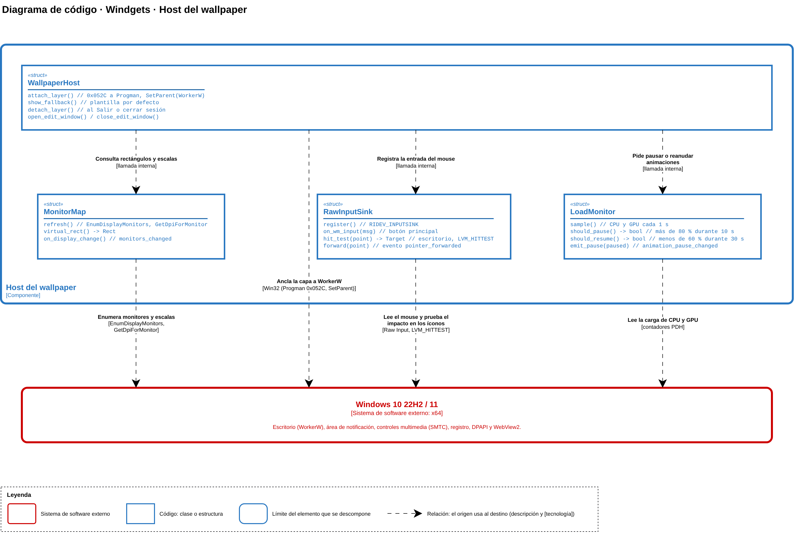

Clases y estructuras del componente Host del wallpaper, con sus funciones y las API de Windows que usan. Es el diseño de partida para construir; los nombres de funciones pueden variar al escribir el código.

### Elementos de la vista 4b

| Nombre | Tipo | Tecnología | Responsabilidad | HU, ET, RNF y D que lo justifican |
|---|---|---|---|---|
| WallpaperHost | Clase (struct) | Rust · Win32 | `attach_layer()  // 0x052C a Progman, SetParent(WorkerW)`; `show_fallback()  // plantilla por defecto`; `detach_layer()  // al Salir o cerrar sesión`; `open_edit_window() / close_edit_window()` | HE-02-HU01; RNF-35; D-131, D-185 |
| MonitorMap | Clase (struct) | Rust · Win32 | `refresh()  // EnumDisplayMonitors, GetDpiForMonitor`; `virtual_rect() -> Rect`; `on_display_change()  // monitors_changed` | HE-02-HU01-ET12; RNF-34; D-187 |
| RawInputSink | Clase (struct) | Rust · Win32 | `register()  // RIDEV_INPUTSINK`; `on_wm_input(msg)  // botón principal`; `hit_test(point) -> Target  // escritorio, LVM_HITTEST`; `forward(point)  // evento pointer_forwarded` | HE-06-HU01; RNF-35; D-186 |
| LoadMonitor | Clase (struct) | Rust · contadores PDH | `sample()  // CPU y GPU cada 1 s`; `should_pause() -> bool  // más de 80 % durante 10 s`; `should_resume() -> bool  // menos de 60 % durante 30 s`; `emit_pause(paused)  // animation_pause_changed` | HE-04-HU09; RNF-06; D-054 |
| Windows 10 22H2 / 11 | Sistema de software externo | x64 | Escritorio (WorkerW), área de notificación, controles multimedia (SMTC), registro, DPAPI y WebView2. | D-050, D-131, D-175, D-192; RNF-32, RNF-33 |

### Límites de la vista 4b

| Límite | Tipo | Tecnología | Contiene |
|---|---|---|---|
| Host del wallpaper | Componente | — | WallpaperHost, MonitorMap, RawInputSink, LoadMonitor |

### Relaciones de la vista 4b

| Origen | Destino | Descripción | Protocolo o tecnología |
|---|---|---|---|
| WallpaperHost | MonitorMap | Consulta rectángulos y escalas | llamada interna |
| WallpaperHost | RawInputSink | Registra la entrada del mouse | llamada interna |
| WallpaperHost | LoadMonitor | Pide pausar o reanudar animaciones | llamada interna |
| WallpaperHost | Windows 10 22H2 / 11 | Ancla la capa a WorkerW | Win32 (Progman 0x052C, SetParent) |
| MonitorMap | Windows 10 22H2 / 11 | Enumera monitores y escalas | EnumDisplayMonitors, GetDpiForMonitor |
| RawInputSink | Windows 10 22H2 / 11 | Lee el mouse y prueba el impacto en los íconos | Raw Input, LVM_HITTEST |
| LoadMonitor | Windows 10 22H2 / 11 | Lee la carga de CPU y GPU | contadores PDH |

## C4 · 14. Vista D1 · Despliegue: computador del usuario y Supabase

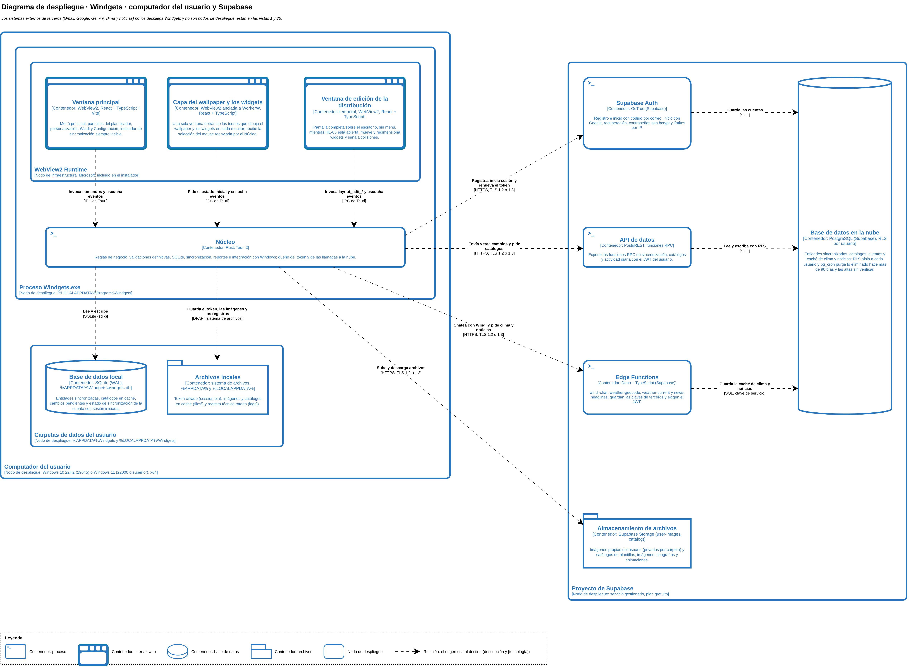

Dónde se ejecuta cada contenedor: el computador del usuario (Windows 10 22H2 o Windows 11, x64), con el proceso Windgets.exe, WebView2 y las carpetas `%APPDATA%` y `%LOCALAPPDATA%`, y el proyecto de Supabase en su plan gratuito.

Los sistemas externos de terceros (Gmail, Google, Gemini, clima y noticias) no los despliega Windgets y no son nodos de despliegue: están en las vistas 1 y 2b.

### Elementos de la vista D1

| Nombre | Tipo | Tecnología | Responsabilidad | HU, ET, RNF y D que lo justifican |
|---|---|---|---|---|
| Ventana principal | Contenedor | WebView2, React + TypeScript + Vite | Menú principal, pantallas del planificador, personalización, Windi y Configuración; indicador de sincronización siempre visible. | HE-01 a HE-04, HE-07 a HE-17; D-179, D-185, D-188, D-203 |
| Capa del wallpaper y los widgets | Contenedor | WebView2 anclada a WorkerW, React + TypeScript | Una sola ventana detrás de los íconos que dibuja el wallpaper y los widgets en cada monitor; recibe la selección del mouse reenviada por el Núcleo. | HE-02-HU01, HE-04, HE-06; D-131, D-185, D-186, D-187 |
| Ventana de edición de la distribución | Contenedor | temporal, WebView2, React + TypeScript | Pantalla completa sobre el escritorio, sin menú, mientras HE-05 está abierta; mueve y redimensiona widgets y señala colisiones. | HE-05; D-185 |
| Núcleo | Contenedor | Rust, Tauri 2 | Reglas de negocio, validaciones definitivas, SQLite, sincronización, reportes e integración con Windows; dueño del token y de las llamadas a la nube. | HE-01 a HE-17; D-179, D-188, D-189, D-191, D-192 |
| Base de datos local | Contenedor | SQLite (WAL), %APPDATA%\Windgets\windgets.db | Entidades sincronizadas, catálogos en caché, cambios pendientes y estado de sincronización de la cuenta con sesión iniciada. | HE-15-HU02; RNF-12, RNF-14; D-164, D-179, D-190 |
| Archivos locales | Contenedor | sistema de archivos, %APPDATA% y %LOCALAPPDATA% | Token cifrado (session.bin), imágenes y catálogos en caché (files\) y registro técnico rotado (logs\). | RNF-19, RNF-22, RNF-23; D-192, D-196, D-198 |
| Supabase Auth | Contenedor | GoTrue (Supabase) | Registro e inicio con código por correo, inicio con Google, recuperación, contraseñas con bcrypt y límites por IP. | HE-01; RNF-17, RNF-20, RNF-24, RNF-25; D-176, D-195 |
| API de datos | Contenedor | PostgREST, funciones RPC | Expone las funciones RPC de sincronización, catálogos y actividad diaria con el JWT del usuario. | HE-15; RNF-03, RNF-04, RNF-21; D-048, D-049, D-189 |
| Edge Functions | Contenedor | Deno + TypeScript (Supabase) | windi-chat, weather-geocode, weather-current y news-headlines; guardan las claves de terceros y exigen el JWT. | HE-14, HE-04-HU05, HE-04-HU06; RNF-09, RNF-11; D-132, D-180, D-192 |
| Almacenamiento de archivos | Contenedor | Supabase Storage (user-images, catalog) | Imágenes propias del usuario (privadas por carpeta) y catálogos de plantillas, imágenes, tipografías y animaciones. | RNF-21, RNF-22, RNF-23; D-180, D-198 |
| Base de datos en la nube | Contenedor | PostgreSQL (Supabase), RLS por usuario | Entidades sincronizadas, catálogos, cuentas y caché de clima y noticias; RLS aísla a cada usuario y pg_cron purga lo eliminado hace más de 90 días y las altas sin verificar. | HE-15; RNF-21; D-133, D-180 |

### Límites de la vista D1

| Límite | Tipo | Tecnología | Contiene |
|---|---|---|---|
| Computador del usuario | Nodo de despliegue | Windows 10 22H2 (19045) o Windows 11 (22000 o superior), x64 | Proceso Windgets.exe, Carpetas de datos del usuario |
| Proceso Windgets.exe | Nodo de despliegue | %LOCALAPPDATA%\Programs\Windgets | Núcleo, WebView2 Runtime |
| WebView2 Runtime | Nodo de infraestructura | Microsoft, incluido en el instalador | Ventana principal, Capa del wallpaper y los widgets, Ventana de edición de la distribución |
| Carpetas de datos del usuario | Nodo de despliegue | %APPDATA%\Windgets y %LOCALAPPDATA%\Windgets | Base de datos local, Archivos locales |
| Proyecto de Supabase | Nodo de despliegue | servicio gestionado, plan gratuito | Supabase Auth, API de datos, Edge Functions, Almacenamiento de archivos, Base de datos en la nube |

- **Computador del usuario.** Equipo donde se instala Windgets para el usuario actual, sin permisos de administrador.
- **Proceso Windgets.exe.** Un solo proceso por usuario: ejecuta el Núcleo y crea las ventanas WebView2.
- **WebView2 Runtime.** Motor web que ejecuta las tres vistas React; el instalador completo evita descargas durante la instalación.
- **Carpetas de datos del usuario.** windgets.db, session.bin (DPAPI), files\ con caché de catálogos e imágenes y logs\ (5 archivos de 1 MB).
- **Proyecto de Supabase.** Atiende cuentas, funciones RPC, Edge Functions y archivos con TLS 1.2 o 1.3; las claves de terceros están en sus secretos.

### Relaciones de la vista D1

| Origen | Destino | Descripción | Protocolo o tecnología |
|---|---|---|---|
| Ventana principal | Núcleo | Invoca comandos y escucha eventos | IPC de Tauri |
| Capa del wallpaper y los widgets | Núcleo | Pide el estado inicial y escucha eventos | IPC de Tauri |
| Ventana de edición de la distribución | Núcleo | Invoca layout_edit_* y escucha eventos | IPC de Tauri |
| Núcleo | Base de datos local | Lee y escribe | SQLite (sqlx) |
| Núcleo | Archivos locales | Guarda el token, las imágenes y los registros | DPAPI, sistema de archivos |
| Núcleo | Supabase Auth | Registra, inicia sesión y renueva el token | HTTPS, TLS 1.2 o 1.3 |
| Núcleo | API de datos | Envía y trae cambios y pide catálogos | HTTPS, TLS 1.2 o 1.3 |
| Núcleo | Edge Functions | Chatea con Windi y pide clima y noticias | HTTPS, TLS 1.2 o 1.3 |
| Núcleo | Almacenamiento de archivos | Sube y descarga archivos | HTTPS, TLS 1.2 o 1.3 |
| Supabase Auth | Base de datos en la nube | Guarda las cuentas | SQL |
| API de datos | Base de datos en la nube | Lee y escribe con RLS | SQL |
| Edge Functions | Base de datos en la nube | Guarda la caché de clima y noticias | SQL, clave de servicio |

## C4 · 15. Vista D2 · Despliegue: distribución

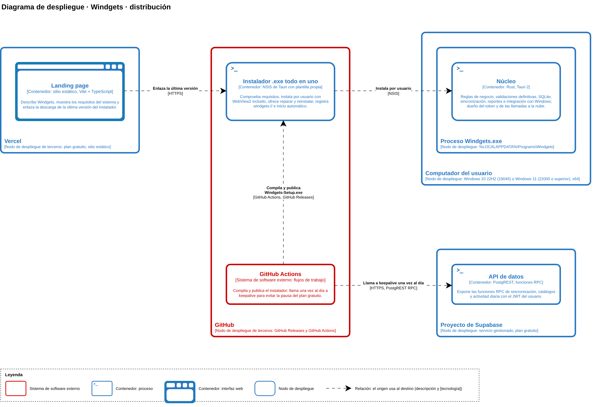

Dónde se aloja y cómo llega la distribución: la landing page en Vercel, el instalador en GitHub Releases, GitHub Actions que lo compila y llama a `keepalive`, y el computador donde se instala.

### Elementos de la vista D2

| Nombre | Tipo | Tecnología | Responsabilidad | HU, ET, RNF y D que lo justifican |
|---|---|---|---|---|
| Landing page | Contenedor | sitio estático, Vite + TypeScript | Describe Windgets, muestra los requisitos del sistema y enlaza la descarga de la última versión del instalador. | CD-01; D-195 |
| Instalador .exe todo en uno | Contenedor | NSIS de Tauri con plantilla propia | Comprueba requisitos, instala por usuario con WebView2 incluido, ofrece reparar y reinstalar, registra windgets:// e inicio automático. | CD-02; RNF-15; D-179, D-194 |
| GitHub Actions | Sistema de software externo | flujos de trabajo | Compila y publica el instalador; llama una vez al día a keepalive para evitar la pausa del plan gratuito. | D-133, D-197; HE-15-HU01-ET09 |
| Núcleo | Contenedor | Rust, Tauri 2 | Reglas de negocio, validaciones definitivas, SQLite, sincronización, reportes e integración con Windows; dueño del token y de las llamadas a la nube. | HE-01 a HE-17; D-179, D-188, D-189, D-191, D-192 |
| API de datos | Contenedor | PostgREST, funciones RPC | Expone las funciones RPC de sincronización, catálogos y actividad diaria con el JWT del usuario. | HE-15; RNF-03, RNF-04, RNF-21; D-048, D-049, D-189 |

### Límites de la vista D2

| Límite | Tipo | Tecnología | Contiene |
|---|---|---|---|
| Vercel | Nodo de despliegue de terceros | plan gratuito, sitio estático | Landing page |
| GitHub | Nodo de despliegue de terceros | GitHub Releases y GitHub Actions | Instalador .exe todo en uno, GitHub Actions |
| Computador del usuario | Nodo de despliegue | Windows 10 22H2 (19045) o Windows 11 (22000 o superior), x64 | Proceso Windgets.exe |
| Proceso Windgets.exe | Nodo de despliegue | %LOCALAPPDATA%\Programs\Windgets | Núcleo |
| Proyecto de Supabase | Nodo de despliegue | servicio gestionado, plan gratuito | API de datos |

- **Vercel.** Sirve la landing page, sin servidor propio; el mismo sitio se puede publicar en el servidor del patrocinador como última opción.
- **GitHub.** Aloja el instalador en Releases y ejecuta los flujos de publicación y de actividad diaria.
- **Computador del usuario.** Equipo donde se instala Windgets para el usuario actual, sin permisos de administrador.
- **Proceso Windgets.exe.** Un solo proceso por usuario: ejecuta el Núcleo y crea las ventanas WebView2.
- **Proyecto de Supabase.** Atiende cuentas, funciones RPC, Edge Functions y archivos con TLS 1.2 o 1.3; las claves de terceros están en sus secretos.

### Relaciones de la vista D2

| Origen | Destino | Descripción | Protocolo o tecnología |
|---|---|---|---|
| Landing page | Instalador .exe todo en uno | Enlaza la última versión | HTTPS |
| GitHub Actions | Instalador .exe todo en uno | Compila y publica Windgets-Setup.exe | GitHub Actions, GitHub Releases |
| Instalador .exe todo en uno | Núcleo | Instala por usuario | NSIS |
| GitHub Actions | API de datos | Llama a keepalive una vez al día | HTTPS, PostgREST RPC |

## C4 · Responsabilidades de Rust y de React (D-188)

| Responsabilidad | Núcleo (Rust) | Vistas (React + TypeScript) |
|---|---|---|
| Reglas de negocio y validaciones definitivas | Todas; vuelve a validar lo que la vista ya validó. | Repite solo las validaciones de campo para mostrar el mensaje al instante. |
| Datos locales y sincronización | SQLite, cola de cambios pendientes, envío y consulta, indicador de sincronización. | Muestra el estado y la cantidad de cambios pendientes. |
| Cuenta y sesión | Llamadas a Supabase Auth, PKCE, renovación, token con DPAPI. | Pantallas de registro, verificación, inicio de sesión y recuperación. |
| Nube y servicios externos | Único cliente de Supabase; clima, noticias y Windi por Edge Functions. | Nunca llaman a la nube ni a servicios externos. |
| Windows | WorkerW, Raw Input, monitores, SMTC, área de notificación, inicio automático, instancia única, carga de CPU y GPU. | Reciben eventos (por ejemplo `pointer_forwarded`, `media_session_changed`); no usan API del sistema. |
| Reportes | Calculan todos los indicadores y series. | Dibujan las secciones cuando llegan. |
| Tipos compartidos | Definidos en Rust; se generan a TypeScript con ts-rs. | Solo los usan; no los redefinen. |
| Wallpaper y widgets | Deciden la distribución, los monitores y la pausa de animaciones. | Dibujan la plantilla y los widgets con los datos recibidos. |

## C4 · Flujos críticos

Cada flujo se resume aquí; el detalle paso a paso está en los diagramas de secuencia del catálogo de contratos (comandos IPC, eventos, funciones RPC, Edge Functions e integraciones INT-01 a INT-13).

### Registro (HE-01-HU01 a HE-01-HU03)

1. Pantallas de cuenta invoca `auth_register_start` (IPC-AUTH-01) por el Cliente IPC tipado.
2. El Puente IPC lo entrega al Servicio de sesión, que valida de nuevo los campos y consulta `email_is_registered` (RPC-05) por el Cliente de Supabase.
3. El Servicio de sesión llama a `POST /auth/v1/signup`; Supabase Auth envía el código de 6 dígitos con vigencia de 10 min por Gmail (SMTP).
4. Al verificar (`auth_register_verify`, IPC-AUTH-02) Auth confirma la cuenta, el disparador crea el perfil y los datos semilla, y el Núcleo guarda el token cifrado con DPAPI en `session.bin`.
5. El Núcleo emite `session_changed` y la ventana principal abre la pantalla principal.

### Inicio de sesión (HE-01-HU04, HE-01-HU05)

1. Con correo: `auth_sign_in` (IPC-AUTH-05) lleva a `POST /auth/v1/token?grant_type=password`; el Núcleo guarda el token y emite `session_changed`.
2. Con Google: `auth_google_start` (IPC-AUTH-06) genera el verificador PKCE y la Integración con el sistema abre el navegador predeterminado.
3. Google autentica, Supabase redirige a `windgets://auth/callback`; Windows entrega la URL a la única instancia, que la pasa al Servicio de sesión.
4. El Servicio de sesión intercambia el código por la sesión (`grant_type=pkce`), guarda el token y emite `auth_google_result`.
5. Sin conexión y con el token vencido se muestra lo guardado en el computador y el token se renueva al recuperar la conexión.

### Aplicar wallpaper (HE-02-HU12, HE-03-HU03, HE-02-HU01)

1. La vista de personalización invoca el comando de aplicar (grupo `theme_*`); el Servicio de personalización y configuración valida y guarda el tema aplicado.
2. Repositorios y archivos locales escribe el tema y su cambio pendiente en una misma transacción de SQLite.
3. El servicio avisa al Host del wallpaper; este mantiene anclada la capa a WorkerW y el Núcleo emite `applied_theme_changed`.
4. El Renderizador del wallpaper redibuja en cada monitor y el Motor de sincronización programa el envío 2 s después.
5. Si la visualización falla, el Host muestra la plantilla por defecto y la ventana principal avisa (`wallpaper_status_changed`).

### Sincronización (HE-15)

1. Cada escritura local guarda la entidad y su cambio pendiente en una misma transacción (Repositorios y archivos locales).
2. El SyncScheduler espera 2 s, agrupa y pide un ciclo al SyncEngine, salvo con el computador suspendido o bloqueado.
3. El SyncEngine envía la cola a `sync_push` (RPC-02) con el desfase de reloj; el servidor combina por campo con su hora y responde por cada cambio.
4. El motor marca lo aceptado, consulta `sync_pull` (RPC-03) desde el último número de secuencia y aplica lo recibido; la consulta ocurre al abrir, al recuperar la conexión, al reanudar y cada 60 s.
5. El Núcleo emite `sync_status_changed` (indicador visible siempre) y, si hubo conflictos resueltos, `sync_conflicts_resolved`. Si la nube no responde, los cambios siguen pendientes y se reintenta cada minuto.

### Conversar con Windi (HE-14)

1. Chat de Windi invoca el comando del grupo `windi_*` con el mensaje.
2. El Servicio de Windi arma el contexto mínimo (tarjetas y etiquetas necesarias, incluidos los cambios sin sincronizar, y el historial en memoria) y llama a `windi-chat` (EF-01) por el Cliente de Supabase con límite de 15 s.
3. La Edge Function llama a Gemini con la clave de sus secretos y devuelve el texto y, si corresponde, una propuesta.
4. La vista muestra «Confirmar» y «Rechazar»; solo al confirmar, el Servicio de Windi pide al Servicio del planificador aplicar el cambio, que vuelve a validar las reglas. Sin conexión antes de confirmar no se aplica nada.

### Instalación (CD-01, CD-02)

1. El visitante consulta la landing page, que detecta el sistema operativo solo con la información del navegador, y pulsa «Descargar para Windows».
2. El navegador descarga `Windgets-Setup.exe` de la última release de GitHub Releases, publicada por GitHub Actions.
3. El instalador verifica su integridad, comprueba Windows 10 22H2 (compilación 19045) o Windows 11, x64 y 500 MB libres, y muestra el paso Opciones.
4. Instala por usuario en `%LOCALAPPDATA%\Programs\Windgets` con WebView2 incluido, crea los accesos directos, registra `windgets://` y, si la casilla está marcada, el inicio automático; ante una falla revierte los cambios.
5. Al abrir Windgets por primera vez se muestra Inicio de sesión y el fondo original de Windows no se toca.

## C4 · Riesgos de arquitectura

| Riesgo | Efecto | Mitigación |
|---|---|---|
| WorkerW y Raw Input (RI-16): la técnica no está documentada por Microsoft y el reenvío del mouse puede fallar en Windows 10 22H2 o Windows 11. | Los widgets interactivos no reciben la selección o rompen el comportamiento del escritorio. | Spike de HE-02-HU01 con permisos estándar en ambos sistemas antes de construir (HE-02-HU01-ET11, D-186); si falla, se informa al Gerente de Proyecto y al patrocinador. |
| Memoria con tres vistas WebView2 y un Núcleo (RNF-07). | Superar 200 MB o 3 % de CPU en reposo. | La ventana de edición es temporal (D-185); medir en el spike; si no cabe, cambia el límite o la estructura de vistas. |
| Límites del plan gratuito de Supabase: 500 MB de base, 1 GB de almacenamiento, 5 GB de salida, pausa por inactividad y límites de Auth por IP. | Servicio detenido o rechazado con muchos usuarios o una sola IP compartida. | `keepalive` diario por GitHub Actions (D-197); caché compartida en las Edge Functions; un servicio de pago requiere aprobación del patrocinador. |
| Cuota del nivel gratuito de Gemini y uso del contenido por el proveedor. | Windi no disponible o datos enviados a un tercero. | Mensaje de servicio no disponible, modelo configurable y envío de datos mínimos (D-132, D-193). |
| Sin firma de código y sin actualización automática (D-194). | Advertencias de Windows al ejecutar el instalador y versiones nuevas manuales. | Texto de ayuda en la landing page; las versiones nuevas se descargan de la landing page; queda como candidato de alcance. |
| Proveedores de clima y noticias sin fijar. | Cambio de límites, términos o formato al construir. | Las Edge Functions aíslan el proveedor; se confirma y se verifican los términos antes de construir. |
| Funciones `pg_cron` y SECURITY DEFINER en el plan gratuito. | Los trabajos de purga podrían no estar disponibles. | Verificar al construir; la purga no afecta las funciones de los usuarios. |

## C4 · Dudas y propuestas

- Las decisiones D-185 a D-200 y D-203 están ratificadas; un cambio se registra como decisión nueva antes de modificar el modelo.
- Los proveedores de clima (Open-Meteo) y de noticias (GNews) son una propuesta; el backlog no los nombra.
- Cada contenedor con estructura interna modelada (Núcleo, Ventana principal, Capa del wallpaper y los widgets, Ventana de edición de la distribución, API de datos y Edge Functions) tiene su vista de componentes; Supabase Auth, la base de datos en la nube, el almacenamiento de archivos, la landing page y el instalador no se descomponen porque no tienen estructura propia que modelar (la purga programada con pg_cron es parte de la base de datos en la nube).
- Cada ventana WebView2 carga su propia instancia del Cliente IPC tipado; por eso aparece en las vistas 3d y 3e con el mismo nombre y el mismo código fuente.
- Los componentes del Núcleo aparecen en más de una vista cuando sirven de extremo de una relación (por ejemplo, el Puente IPC y el Cliente de Supabase).
